# spaceLog · 디자인 문서

- 서비스명: spaceLog
- 버전: v0.6 (2026-11-26)
- 범위: 웹 하나. 홈(W-00), 우주(W-01), 행성 패널(W-02), 별 상세(W-03), 기록하기 · 행성 꾸미기 · 캐릭터 꾸미기 · 별 찾기 · 챗봇 · 로그인 창.
- 다루지 않는 것: 탐사선(W-04), 수집 앱. 둘 다 만들지 않기로 했다.

이 문서는 팀원 누구나 이것만 보고 같은 모양 · 같은 동작의 화면을 만들 수 있게 쓴 것이다. AI에게 넘겨 같은 스타일로 화면을 만들게 할 때도 쓴다. 규칙은 "~한다 / ~하지 않는다"로 단정해서 쓰고, 헷갈리기 쉬운 규칙에는 까닭을 붙인다.

**기준은 지금 돌아가는 앱의 코드다.** 이 문서는 그 코드의 설명서다. 문서와 앱이 다르면 앱이 맞고, 문서를 고친다. 값이 궁금하면 아래 파일을 본다.

| 알고 싶은 것 | 볼 곳 |
|---|---|
| 색 · 서체 · 간격 · 쌓임 순서 | `web/src/styles/tokens.css` |
| 버튼 · 카드 · 목록 같은 기본 모양 | `web/src/styles/app.css` |
| 누르는 순간의 반응 | `web/src/styles/press.css` |
| 화면별 스타일 | `home.css` · `planet.css` · `detail.css` · `save.css` · `chat.css` · `character.css` · `account.css` · `rowmenu.css` |
| 화면의 뼈대 | `web/index.html` |
| 서버 · 데이터 동작(한도, 저장 방식, 챗봇 색인) | `docs/superpowers/specs/`의 스펙 문서 |

---

## 0. 새 화면을 만들 때 읽는 순서

1. **3장 토큰**: 색 · 서체 · 간격은 여기 값만 쓴다. 새 값을 만들지 않는다.
2. **4장 공통 규칙**: 어느 화면에나 걸리는 규칙이다. 누르는 반응, 잠긴 버튼, 필수 칸, 모서리, 좁은 화면.
3. **5장 컴포넌트**: 이미 있는 부품을 가져다 쓴다. 비슷한 것을 새로 만들지 않는다.
4. **6장 화면별 명세**: 만들 화면과 가장 비슷한 화면을 찾아 같은 구조로 짠다.
5. 다 만든 뒤 **11장 완료 확인 목록**으로 스스로 점검한다.

---

## 1. 컨셉과 원칙

> 내가 막연히 기록하는 것들이 하나의 별, 행성, 우주가 된다.

| 현실 | 우주에서 | 비고 |
|---|---|---|
| 기록 1개 | 별 | 행성 주위를 돈다. 글 · 파일 · 이미지 · 링크를 함께 담을 수 있다 |
| 카테고리 | 행성 | 기간 안의 별이 많을수록 커진다 |
| 기간 안의 기록 전체 | 우주 | 기본 기간은 오늘 |

1. **조작 없이 다 보인다.** 우주에 들어오면 조망 상태에서 모든 행성이 한 화면에 보인다.
2. **홈에서 다 할 수 있다.** 찾기 · 읽기 · 고치기 · 옮기기 · 지우기는 홈의 목록에서 끝난다. 우주는 보고 돌아다니는 곳이다.
3. **비행은 선택이다.** 목록과 버튼만으로 모든 일을 할 수 있어야 한다.
4. **홈과 우주는 같은 것을 같은 모양으로 보여 준다.** 같은 일을 하는 창 · 메뉴 · 문구는 두 곳에서 똑같다. 기간도 두 곳이 같은 값을 쓴다.
5. **파일과 기록은 내 PC에 있다.** 챗봇을 켜면 질문에 필요한 내용과 색인할 내용만 OpenAI로 보내지고, 화면에서 이 사실을 숨기지 않는다. 화면 문구: "파일과 기록은 내 PC에 있고, 챗봇을 켜면 질문에 필요한 내용과 색인할 내용만 OpenAI로 보내져요."

---

## 2. 비주얼 방향

장난감 같은 툰 3D. 두꺼운 잉크 외곽선, 3단계로 끊긴 음영, 각진 로우폴리 면, 2등신 캐릭터.

| 한다 | 하지 않는다 |
|---|---|
| 모든 3D 물체에 잉크색 외곽선 | 사실적인 질감, 반사, 블룸 남발 |
| 음영은 3단계로 끊는다 | 부드러운 그라데이션 음영 |
| 행성 면은 각지게(Icosahedron, flat shading) | 매끈한 구 |
| 2D UI는 잉크 테두리 + 아래로 떨어지는 단색 그림자. 굵기는 세 단계로 나눈다(3-3) | 흐린 그림자, 유리 효과(blur), 모든 것에 같은 굵은 테두리 |
| 원색에 가까운 밝은 색, 면적은 작게 | 화면 전체를 채도 높은 색으로 칠하기 |
| 배경은 짙은 남보라 우주 | 순수한 검정 배경 |
| 오래 보는 움직임은 느리게 | 계속 빠르게 도는 장식(어지럽다는 피드백이 있었다) |
| 둥근 사각형 안에는 둥근 사각형(4장 "모서리") | 둥근 사각형 카드 안에 알약 버튼 |

---

## 3. 토큰

값은 `web/src/styles/tokens.css`에 있다. 화면에는 이 변수만 쓴다.

### 3-1. 컬러

```css
:root {
  --ink:     #1a1430; /* 외곽선, 본문 글자, 그림자, 배지 바탕 */
  --space:   #15103a; /* 우주 배경, 웹 전체 바탕 */
  --panel:   #f4f2ff; /* 카드 · 패널 바탕 */
  --panel-2: #e6e2ff; /* 패널 안 2차 면, 고스트 버튼, 잠긴 버튼. 올림(hover) 바탕 --hover가 이 색을 쓴다(3-3) */
  --mute:    #5b5480; /* 보조 글자, 날짜, 안내, 잠긴 글자 */
  --white:   #ffffff; /* 목록 항목, 입력창, 미리보기 바탕 */

  --yellow:  #ffd23f; /* 기본 버튼, 선택된 항목, 별, 찾은 낱말 */
  --pink:    #ff5d8f; /* 고른 별, 새 항목 강조, 지우기 확정, 기간 좁힘 점 */
  --violet:  #7a6cff; /* 우주로 들어가기, 로고 글자, 채움 · 테두리 · 큰 글자 */
  --violet-text: #5a4ad1; /* 작은 글자 라벨(12 ~ 13px): .lbl, .eyebrow, 왼쪽 패널 라벨. --violet은 --panel 위에서 3.5:1이라 작은 글자 AA(4.5:1)에 못 미친다 */
  --sky:     #5ec8ff; /* 키보드 포커스 링 */

  --notice:  #fff4c2; /* 띠 배너 */
  --danger-text: #c2185b; /* 지우기 글자, 오류 글, 필수 표시(*) */
}
```

토큰에 없는 색 네 가지를 정해 둔다.

| 색 | 쓰는 곳 |
|---|---|
| `#d6d1f2` | 목록 줄 사이의 얇은 선, 메뉴 안 구분선, 스위치 사이 세로 줄 |
| `#8a84ad` | 값을 모를 때의 "미확인" 글자 |
| `rgba(10, 6, 30, .6)` | 창 뒤를 덮는 막 |
| `rgba(20, 12, 50, .10)` | 누르는 순간 덧씌우는 어두운 막(4장) |

**행성 색 16가지.** 사용자가 행성 꾸미기 창에서 고른다. 새 행성은 만든 순서대로 1번부터 미리 골라져 있다.

| 번호 | 이름 | 면 색 | 진한 색 | | 번호 | 이름 | 면 색 | 진한 색 |
|---|---|---|---|---|---|---|---|---|
| 1 | 주황 | `#ff7a59` | `#b23a1c` | | 9 | 빨강 | `#ff5a5a` | `#b3202a` |
| 2 | 하늘 | `#5ec8ff` | `#0f6aa8` | | 10 | 민트 | `#7cf0b0` | `#157a4a` |
| 3 | 연두 | `#8fdc5a` | `#2f7a1e` | | 11 | 파랑 | `#4f8dff` | `#1f4fc0` |
| 4 | 연보라 | `#c29bff` | `#6a3fc8` | | 12 | 자주 | `#d96bff` | `#8a22b8` |
| 5 | 호박 | `#ffb13b` | `#8f5a00` | | 13 | 라임 | `#c6e84a` | `#566e00` |
| 6 | 분홍 | `#ff6fb5` | `#b0246f` | | 14 | 살구 | `#ffc9a3` | `#9a4a1c` |
| 7 | 청록 | `#4fd1c5` | `#0d7068` | | 15 | 은회색 | `#b9c6e0` | `#48587a` |
| 8 | 남보라 | `#9aa7ff` | `#3f4fc0` | | 16 | 코코아 | `#c98a5a` | `#7a4520` |

- 글자는 `--ink` 또는 `--white`만 쓴다. 노랑 바탕에는 `--ink`, 보라 · 핑크 바탕에는 `--white`.
- 화면 하나에 포인트 색 버튼은 2가지까지만.
- 다크 테마 하나만 쓴다. 카드 안쪽만 밝다. 밝은 카드 안의 체크박스 · 라디오 · 선택 상자 · 날짜 칸이 어둡게 나오지 않도록 카드에 `color-scheme: light`를 준다(`.card`에 이미 들어 있다).
- **면 색**은 3D 행성, 색 점에 쓴다. **진한 색**은 밝은 패널 위의 글자 · 선에 쓴다.
- **패널 포인트 색**: 행성 패널(W-02)과 별 상세(우주 · 홈 모두)의 루트에 `--accent: (그 행성의 진한 색)`을 준다. 그 안의 포커스 링, 행성 아이콘 바깥 링, 이미지 크게 보기 링이 이 색을 쓴다. 라벨은 쓰지 않는다: 라벨은 앱 전체에서 `--violet-text` 한 색이다(차분한 화면 1단계). 그 밖의 포커스 링은 `--sky`다.

### 3-2. 타이포그래피

```css
:root {
  --f-display: "Black Han Sans", "Apple SD Gothic Neo", "Malgun Gothic", sans-serif;
  --f-body:    "Pretendard Variable", Pretendard, "Apple SD Gothic Neo", "Malgun Gothic", sans-serif;
  --f-mono:    "IBM Plex Mono", ui-monospace, Consolas, monospace;
}
```

| 역할 | 서체 | 크기 / 굵기 | 쓰는 곳 |
|---|---|---|---|
| 로고 | display | 24px (좁은 화면 18px) | 로고 |
| 큰 제목 | display | clamp(24px, 3.4vw, 34px) | 홈 인사말 |
| 화면 제목 | display | 24px | 행성 패널의 행성 이름 |
| 별 제목 | display | 19px(우주 패널) · 22px(홈 상세), 줄간격 1.25 | 별 상세 머리 |
| 창 제목 | display | 20px | 기록하기 · 행성 꾸미기 · 캐릭터 꾸미기 창, 패널 제목 |
| 확인 창 제목 | body | 17px / 700, 줄간격 1.4 | 지우기 · 옮기기 같은 확인 창 |
| 목록 제목 | body | 15.5px / 700 | 홈 별 목록의 제목 |
| 버튼 | display | 15px (작은 버튼 13px, 우주로 들어가기 16px) | 모든 버튼 |
| 라벨 | display | 12px, 자간 0.06em, `--violet-text`(작은 글자 대비 때문. 패널 안에서도 같다) | 칸 이름표, "첨부 1개", "메모" |
| 본문 | body | 14px / 600, 줄간격 1.6 | 목록, 상세, 메뉴 항목 |
| 보조 | body | 12.5px / 500, `--mute` | 부제, 안내, 종류 |
| 안내 · 오류 | body | 12 ~ 13px. 안내는 600 `--mute`, 오류는 700 `--danger-text` | 칸 아래 안내, 잠긴 까닭, 오류 |
| 날짜 · 숫자 | mono 또는 body + `tabular-nums` | 11.5 ~ 13.5px | 목록 날짜, 글자 수 |

- 제목은 Black Han Sans, 본문은 Pretendard, 날짜 · 글자 수 · 주소는 IBM Plex Mono.
- **Black Han Sans는 18px 이상 제목에만 쓴다.** 획이 두꺼워 16px 이하에서는 받침이 메워져 뭉개진다. 버튼 · 라벨 · 배지 · 탭 같은 작은 글씨는 Pretendard 800.
- 한글은 단어 단위로 줄을 바꾼다(`word-break: keep-all`, `body`에 들어 있다). 버튼 · 탭 · 키 표시는 줄바꿈하지 않는다(`white-space: nowrap`).
- 인터넷 없이도 열려야 한다. 서체는 npm 패키지에서 번들로 넣고 CDN에 의존하지 않는다.

### 3-3. 모양과 간격

```css
:root {
  --line: 2px;   --line-thin: 2px;   --line-btn: 2.5px;   --line-row: 1.5px;
  --ring: 3px;   /* 포커스 링 굵기 */
  --row-line: #c9c2ec;   /* 목록 줄 테두리 */
  --thumb-line: #b9b1e6; /* 줄 안의 작은 그림 칸 테두리 */
  --sel: #ffe58a;        /* 고른 줄 · 고른 칩 바탕 */
  --hover: var(--panel-2);                                  /* 올림 바탕(연보라 한 색) */
  --hover-2: color-mix(in srgb, var(--ink) 9%, var(--panel-2)); /* 한 단계 진한 올림(≈ #d4d0ec) */
  --r-card: 16px; --r-btn: 12px; --r-item: 12px; --r-thumb: 8px; --r-pill: 999px;
  --drop-card: 0 3px 0 var(--ink);
  --drop-btn:  0 3px 0 var(--ink);
  --gap-1: 6px; --gap-2: 8px; --gap-3: 12px; --gap-4: 16px; --gap-5: 24px;
  --edge: 14px;  /* 화면 가장자리에서 떨어지는 거리 */
}
```

- 그림자는 흐리지 않는다. 항상 아래로 떨어지는 단색 잉크 그림자.
- 형제 요소 사이 간격은 `gap`으로 준다.
- 입력창 · 선택 상자의 모서리는 10px, 테두리는 `--line`(2px 잉크)이다.

**선 굵기 세 단계**(차분한 화면 1단계, 2026-11-26). 모든 부품에 3px 잉크 테두리 + 그림자를 주면 눈이 아프다는 의견에 따라 무게를 나눴다. 툰 느낌(잉크 테두리 · 단색 그림자)은 남긴다.

| 단계 | 무엇 | 테두리 | 그림자 |
|---|---|---|---|
| 창 · 카드 | `.card`(패널, 챗봇 창, 왼쪽 패널, 홈 카드, 꾸미기 · 기록하기 · 확인 창, 메뉴, 토스트), 카드 모양 버튼 | `--line` 2px 잉크 | `--drop-card` 0 3px 0 |
| 기본 버튼 | `.btn`(노랑 · 분홍 · 보라), 챗봇 버튼 | `--line-btn` 2.5px 잉크 | `--drop-btn` 0 3px 0 |
| 보조 · 아이콘 버튼 | `.btn.ghost`, `.btn.x`, 알약 버튼(여러 개 고르기 · 취소) | `--line` 2px 잉크 | 없음 |
| 목록 줄 | 행성 줄, 별 줄, 추천 질문, 대화 줄, 첨부 줄 · 칩, 챗봇 행성 고르기 줄 | `--line-row` 1.5px `--row-line` | 없음 |
| 줄 안의 작은 그림 칸 | 썸네일 `.th`, 이미지 축소본, 첨부 파일 아이콘 | `--line-row` 1.5px `--thumb-line` | 없음 |

- 카드 안의 잉크 구분선(머리 아래 선, 탭 줄 위 선, 묶음 머리 선)과 입력칸 · 검색 · 기간 바는 2px 잉크.
- 예외: 좁은 띠 안에 들어가는 작은 기본 버튼(띠 배너의 버튼, 챗봇 대화의 막힘 안내 띠 버튼, 보내기 동그라미 버튼)은 그림자를 `0 2px 0`으로 더 낮춘다. 띠 높이 안에 들어가게 하려는 것이다.
- 고른 줄 · 고른 칩은 `--sel`(한 단계 연한 노랑) 바탕에 잉크 테두리. 버튼의 노랑은 `--yellow` 그대로.
- 새 행성 줄(홈 `#hsNew` · 우주 `#wNewPlanet`)의 점선 테두리는 목록 줄과 같은 `--row-line` 연보라다(`--line-thin` 2px dashed). 잉크 점선이 아니다.
- 바꾸지 않는 것: 3D 장면, 개수 배지, 포커스 링(3px `--sky`), 위쪽 손잡이(3px), 색 점 · 행성 아이콘 테두리, 체크칸(2.5px 잉크, 고르는 중 잘 보이게).

**쌓임 순서**(아래에서 위로)

| 층 | z-index | 무엇 |
|---|---|---|
| 3D | 1 | 우주 캔버스 |
| 우주 위 UI | 2 | 왼쪽 패널, 기간 바, 행성 패널, 기록하기 |
| 상태 카드 | 3 | 빈 상태 · 오류 카드 |
| 홈 | 20 | W-00 전체. 그 안에서 붙은 상단 줄 6, 서랍 뒤 막 8, 서랍 9 |
| 챗봇 버튼 | 21 | 홈 · 우주 모두에서 오른쪽 아래 |
| 전환 막 | 30 | 블랙홀 전환 |
| 떠 있는 메뉴 | 40 | ⋯ 메뉴 |
| 놓기 막 | 42 | 파일을 끌고 올 때 |
| 기록하기 창 | 43 | |
| 꾸미기 · 지우기 · 로그인 창 | 44 | 행성 꾸미기, 행성 지우기, 캐릭터 꾸미기, 로그인, 계정 |
| 확인 창 | 45 | 다른 창 위에서도 뜬다 |
| 토스트 | 50 | |

---

## 4. 공통 규칙

어느 화면에나 걸리는 규칙이다. 화면마다 다르게 만들면 팀원마다 결과가 달라지는 것들을 여기 모았다.

### 4-1. 상태: 모든 누를 수 있는 것은 여섯 가지 상태를 가진다

| 상태 | 언제 | 모양 |
|---|---|---|
| 기본 | | 5장의 각 컴포넌트 |
| 올림(hover) | 마우스를 올렸을 때 | 기본 버튼은 1px 위로. 보조 · 아이콘 버튼(`.btn.ghost` · `.btn.x`)은 바탕이 살짝 어두워진다. 그 밖의 줄 · 메뉴 항목 · 아이콘 · 목록 같은 버튼은 바탕이 `--hover`(연보라). 아래 "올림 색은 하나"를 따른다 |
| 누름(active) | 누르고 있는 동안 | 4-2의 세 가지 중 하나 |
| 포커스 | 키보드로 왔을 때 | 3px `--sky` 외곽선, 2px 띄움 |
| 잠김(disabled) | 지금은 누를 수 없을 때 | `--panel-2` 바탕, `--mute` 글자, 그림자 없음, `cursor: not-allowed`. 4-4를 함께 지킨다 |
| 선택됨 | 고른 것 | 지금 행성 줄은 `--sel` 바탕 + 잉크 테두리. 고르기 칩은 `--sel` 바탕 + 더 굵은 잉크 테두리(안쪽 1.5px 그림자) · 800. 여러 개 고르는 중에 고른 별 줄은 옅은 노랑(`--yellow` 22%) + 잉크 테두리(홈 표의 줄은 테두리 없이 바탕만). 챗봇의 행성 고르기 줄(`.cp-chk`)은 체크하면 연보라 바탕 + `--violet` 테두리. 펼친 버튼은 `--yellow` 바탕. 기간 버튼 · 탭은 `--ink` 바탕에 `--yellow` 글자 |

- **올림은 마우스가 있는 기기에서만 건다.** 모든 `:hover` 규칙은 `@media (hover: hover) { … }` 안에 쓴다. 까닭: 폰은 탭한 뒤에도 올림 상태가 남아서, 버튼이 떠 있거나 색이 바뀐 채로 보인다.
- 올렸을 때만 나타나는 것(⋯ 버튼)은 터치 화면에서 늘 보이게 한다(`@media (hover: none)`).
- **올림 색은 하나: 연보라.** 새 규칙은 색 값을 직접 쓰지 않고 토큰을 쓴다.
  - `--hover`(= `--panel-2`): 목록 줄(행성 줄 · 별 줄 · 대화 줄 · 추천 질문 · 찾기 결과 · 출처 · 챗봇 행성 고르기 줄), 메뉴 항목(⋯ 메뉴 · 내 메뉴), 흰색 · 패널 바탕 버튼(새 행성, 기간 버튼, 스위치, ☆, 찾기 · 시계 · 펼치기 카드 버튼, 파일 첨부 · 별로 저장, 장식 칩).
  - `--hover-2`(한 단계 진한 연보라): ① 올린 줄 안의 작은 버튼 — 줄의 ⋯, 고르기 체크칸(`.pickcb`), 알약 "여러 개 고르기 / 취소"(`.pickbtn`). 줄이 이미 `--hover`라 같은 색이면 버튼이 안 보인다. ② `--panel-2` 면 위에 놓인 버튼 — 행성 패널 메뉴(`.menu`), 챗봇 아래 탭, 찾기 칸의 ✕.
  - 고른(노랑) 줄 위의 ⋯는 노랑을 한 단계 어둡게(`--ink` 10% + `--sel`).
  - **노랑은 올림에 쓰지 않는다.** 노랑은 고른 것(`--sel`), 펼친 버튼(`aria-expanded`), 기본 버튼에만 쓴다.
  - 올림 색을 바꾸지 않는 것: 기본 버튼 · 물어보기 버튼 · 보내기 버튼(1px 위로), 보조 · 아이콘 `.btn`(살짝 어두워짐), 위쪽 손잡이(늘어남 + 말풍선), 글자 링크(밑줄).

### 4-2. 누르는 순간의 반응

폰에는 올림이 없어서, 누르는 순간 반응이 없으면 "눌렸는지" 알 수 없다. 누를 수 있는 것은 모두 아래 셋 중 하나로 반응한다. 데스크톱에서도 같이 보인다. 규칙은 `press.css`에 모여 있고, 새로 만든 부품은 거기 목록에 더한다.

| 종류 | 무엇에 | 누르는 동안 |
|---|---|---|
| ① 꺼짐 | 그림자가 있는 버튼: 기본 `.btn`, 결정 버튼 짝의 취소(5-2), 챗봇 버튼, 카드 모양 버튼(찾기 · 시계 · 펼치기) | 2px 아래로, 그림자 `0 1px 0`(3px 그림자에 딱 닿는다). 보조 · 아이콘 `.btn`은 그림자가 없어 1px 아래로 + ②의 막 |
| ② 어두워짐 | 목록 줄(행성 줄 포함), 메뉴 항목, 출처 카드 | 바탕 위에 어두운 막(`inset 0 0 0 100vmax rgba(20,12,50,.10)`) |
| ③ 어두워짐 + 줄어듦 | 작은 아이콘 · 알약 · 스위치: ☆, ⋯, ✕, 기간 버튼, 스위치, 색 원, 장식 칩 | ②에 더해 0.94배 |

- 누르는 즉시 나타나고(전환 0초), 손을 떼면 0.15초에 돌아온다.
- "어두워짐"을 색 바꾸기가 아니라 막 덧씌우기로 하는 까닭: 바탕이 흰색 · 노랑 · 연보라 어느 것이든 같은 만큼 어두워져서, 부품마다 누름 색을 따로 정하지 않아도 된다.
- 브라우저의 기본 탭 하이라이트(회색 네모)는 끈다(`-webkit-tap-highlight-color: transparent`).
- iOS Safari는 터치 리스너가 하나도 없으면 `:active`를 보여 주지 않는다. `main.js`에 빈 `touchstart` 리스너가 있다. 지우지 않는다.
- 모션 줄이기 설정이면 꺼짐 · 줄어듦은 빼고 색만 바뀐다.

### 4-3. 누르는 영역

누를 수 있는 요소의 누르는 영역은 최소 44px이다. 보이는 크기가 작은 것(34px 버튼, ☆, 스위치, 기간 버튼)은 보이는 크기를 그대로 두고 `::after`로 투명한 영역만 넓힌다.

### 4-4. 잠긴 버튼에는 까닭을 붙인다

- 잠긴 버튼은 **회색**이다. 노란 채로 두지 않는다. 까닭: 누를 수 있어 보이는데 눌러도 반응이 없으면 고장으로 보인다.
- 처리 중(저장 중 · 띄우는 중)은 다르다. 버튼에 `aria-busy="true"`를 주고, 글자를 "저장 중…"처럼 바꾸며, 색은 그대로 둔다.
- 잠긴 버튼 가까이에 **왜 잠겼는지, 무엇을 하면 풀리는지**를 한 줄로 알린다. 12 ~ 12.5px, 600, `--mute`. 풀리면 사라진다.
  - 칸 하나가 비어서 잠긴 경우: 그 칸 바로 아래 왼쪽. 예: "이름을 적으면 만들 수 있어요"
  - 여러 가지 중 하나가 있어야 하는 경우: 버튼 바로 위 오른쪽. 예: "메모를 쓰거나 파일·링크를 넣으면 띄울 수 있어요"
  - 까닭이 여럿이면 한 번에 하나만 보인다.
- 이 안내는 오류가 아니다. 창을 열자마자 보이므로 빨간색을 쓰지 않는다. 빨간 글(`--danger-text`, 700)은 사용자가 넘긴 것(20자 초과, 주소가 아님)과 실패에만 쓴다.

### 4-5. 필수 칸

- 꼭 채워야 하는 칸은 이름표 뒤에 분홍 별표(`*`, `--danger-text`, 왼쪽 3px 띄움)를 붙인다. 별표에는 `aria-hidden="true"`, 입력칸에는 `aria-required="true"`를 준다.
- 선택 칸에는 "선택"을 붙이지 않는다. 칸 안의 안내 글(placeholder)로 알린다. 예: "비워 둬도 돼요"
- 글자 수 한도가 있는 칸은 칸 아래 오른쪽에 "n/20"을 mono 11.5px로 보인다. 넘으면 숫자와 칸 테두리가 `--danger-text`가 되고 아래에 빨간 글이 뜬다.

### 4-6. 모서리와 안쪽 여백

- **안쪽 모서리 = 바깥 모서리 − 테두리 − 안쪽 여백.** 카드(16px) 안에 5px 여백을 두고 넣는 버튼의 모서리는 16 − 3 − 5 = **8px**이다(테두리가 2px이 된 뒤에도 8px을 그대로 쓴다). 그래야 바깥과 안쪽 테두리가 같은 곡선으로 휜다.
- 카드 안에 버튼을 줄지어 넣을 때 안쪽 여백은 사방 5px로 고르게 한다. 위아래와 좌우가 다르면 안쪽 것이 떠 보인다.
- 둥근 사각형 카드 안에 알약(999px) 버튼을 넣지 않는다. 기간 버튼과 스위치의 올림 영역이 8px인 까닭이다.
- 거르기 줄에 나란히 놓는 카드(검색, 스위치 묶음, 기간 바, 좁은 화면의 버튼)는 높이를 50px로 맞춘다(크기는 테두리가 3px이던 때 그대로 둔다).

### 4-7. 비어 있는 것을 물러나 보이게

- 지금 기간에 별이 0개인 행성 줄은 흐리게 한다: 개수 배지는 속이 빈 테두리(`inset 0 0 0 2px var(--mute)`)에 `--mute` 숫자, 색 점은 투명도 45%, 이름은 `--mute`.
- 줄의 테두리 · 누르는 반응은 그대로 둔다. 잠긴 것이 아니라 "이 기간엔 비어 있음"이다. 눌러서 들어갈 수 있다.
- 순서는 바꾸지 않는다. 기간을 바꿀 때마다 목록이 움직이면 위치로 기억할 수 없다.

### 4-8. 좁은 화면(760px 이하)

데스크톱 브라우저가 기본이지만 폰에서도 모든 일을 할 수 있어야 한다.

| 넓은 화면 | 좁은 화면 |
|---|---|
| 왼쪽에 늘 보이는 패널(홈의 행성 패널, 우주의 왼쪽 패널) | 왼쪽에서 덮이는 서랍. 로고 옆 펼치기 아이콘으로 연다. 접기 아이콘 · 바깥 · Esc · 항목 고르기로 닫는다. 열린 동안 뒤쪽은 누를 수 없다(`inert`) |
| 늘 보이는 기간 바 | 시계 버튼을 눌렀을 때만 펼쳐진다. 전체 · 오늘 · 이번 주를 고르면 접히고, 직접 지정은 날짜를 고르게 남는다. 기간이 "전체"가 아니면 시계에 분홍 점 |
| 올렸을 때 나타나는 ⋯ | 늘 보인다 |
| 글자가 있는 버튼 | 자리가 모자라면 아이콘만 남긴다. 이름은 `aria-label`로 그대로 둔다 |
| 표의 칸 여러 개 | 덜 중요한 칸부터 숨기고, 꼭 필요한 값(날짜)은 남은 칸 안으로 옮긴다 |
| 오른쪽 패널(행성 패널) | 아래에서 올라오는 시트 |
| 가운데 창 | 화면 가장자리 여백을 8 ~ 10px로 줄인다 |

- 900px 이하에서는 홈 목록의 메모 칸을 먼저 숨긴다.
- 모든 너비에서 화면 가장자리 여백은 최소 14px(창은 위 표대로).

### 4-9. 키보드

- 모든 일은 키보드만으로 할 수 있어야 한다. 포커스 링을 지우지 않는다.
- 창이 열리면 초점이 창 안으로 들어가고, Tab은 창 안에서 돈다. 닫으면 창을 연 버튼으로 초점이 돌아간다.
- 다시 그린 뒤에도 초점은 같은 것에 남긴다(☆를 누른 뒤 그 ☆, 다음을 누른 뒤 그 다음 버튼).
- 라디오 묶음(색 원, 장식 칩)은 묶음 전체가 Tab 한 자리이고, 그 안은 방향키로 옮긴다.
- **Esc는 맨 위에 있는 것 하나만 닫는다.** 순서는 `web/src/ui/escape.js`에 있다: 확인 창 → 꾸미기 · 지우기 창 → 기록하기 창 → 전환 건너뛰기 → ⋯ 메뉴 → 별 찾기 → 서랍 → 펼친 기간 바 → 손잡이로 내린 위쪽 막대 → 이미지 크게 보기 → 상세에서 목록(홈은 홈 상세 → 홈 고르기 끝내기) → 챗봇 창 → 패널. 우주 패널은 "⋯ 메뉴 → 고르기 모드 → 패널 닫기" 순으로 한 번에 하나씩 끝난다.
- 글을 쓰는 칸 · 창에 초점이 있으면 화면의 단축키(비행 키, 상세의 ←/→)는 받지 않는다.

---

## 5. 컴포넌트

이미 있는 부품이다. 새 화면은 이것을 조합해서 만든다.

### 5-1. 카드

`--panel` 바탕, 2px 잉크 테두리(`--line`), 16px 모서리, `--drop-card`(0 3px 0). 클래스 `.card`. 창 · 패널 · 거르기 줄의 상자 · 목록의 바깥 상자가 모두 카드다.

### 5-2. 버튼

| 종류 | 클래스 | 바탕 / 글자 | 쓰는 곳 |
|---|---|---|---|
| 기본 | `.btn` (`.btn.yellow`) | `--yellow` / `--ink` | 그 화면의 주된 행동: 기록하기, 별 띄우기, 만들기, 저장하기, 옮기기 |
| 보라 | `.btn.violet` | `--violet` / `--white` | 우주로 들어가기 |
| 핑크 | `.btn.pink` | `--pink` / `--white` | 되돌릴 수 없는 확정: 지우기, 합치기, 버리기 |
| 고스트 | `.btn.ghost` | `--panel-2` / `--ink` | 취소, 닫기, 목록으로, 원본 열기, 우주에서 보기 |
| 작은 버튼 | `.btn.sm` | 위와 같음, 13px | 목록 · 상세 안의 보조 행동 |
| 아이콘 버튼 | `.btn.x` | 34px 네모(이전 · 다음은 40px) | ✕, ←, 이전 · 다음 |
| 글자 링크 | `.linkdel` | 투명 / `--danger-text`, 밑줄 | "이 별 지우기"(누르면 확인 창) |

- 기본 · 보라 · 핑크: 2.5px 잉크 테두리(`--line-btn`), 12px 모서리, `--drop-btn`(0 3px 0).
- 고스트 · 아이콘 버튼: 2px 잉크 테두리, 그림자 없음.
- 창 하나에 기본(노랑) 버튼은 하나만 둔다. 까닭: 가장 강한 것이 그 창의 주된 행동이어야 한다. 그 밖의 더하기 버튼(파일 첨부, 링크 붙이기)은 흰 바탕 · 그림자 없음으로 가볍게 한다.
- 버튼 줄은 오른쪽 정렬, 순서는 **취소(왼쪽) → 확정(오른쪽)**.
- **결정 버튼 짝은 둘 다 강하게.** 창 맨 아래에서 확정 버튼 옆에 놓인 취소(고스트)는 확정과 같은 무게를 준다: `--line-btn` 2.5px 잉크 테두리 + `--drop-btn` 그림자, 누르면 기본 버튼처럼 꺼진다(2px 아래 · `0 1px 0`). 바탕은 고스트의 `--panel-2` 그대로, 올리면 확정 버튼처럼 1px 떠오르고 바탕은 바뀌지 않는다.
  - 쓰는 곳: 기록하기 창 [취소 | 별 띄우기], 행성 꾸미기 · 캐릭터 꾸미기 창 [취소 | 만들기 · 저장하기], 확인 창 [취소 | 옮기기 · 지우기 · 합치기], 행성 지우기 창, 로그인 · 계정 창, 챗봇 켜기 확인 [취소 | 켜기], 여러 개 고르기 아래 바 [행성 옮기기 | 지우기](흰 바탕 · `--danger-text` 지우기도 2.5px 테두리 + 그림자).
  - 선택자: `:is(#save, #planetForm, #charForm, #planetDel, #confirm, .authdlg, .cp-consent) .row > .btn.ghost`(app.css), 아래 바는 `.pickbar .btn`. 새 창의 버튼 줄도 `.row`에 두면 이 목록에 더한다.
  - 쓰지 않는 곳: 홈 위 줄(기록하기 | 로그아웃 | 내 메뉴), 우주 왼쪽 패널(홈 | 캐릭터 | 내 메뉴), 머리의 ✕ · ⋯ 아이콘 버튼, 알약 버튼(여러 개 고르기 · 취소). 결정을 끝내는 짝이 아니라서 보조 무게(2px · 그림자 없음) 그대로 둔다.
- 올림: 기본 버튼은 1px 위로, 고스트 · 아이콘은 바탕이 살짝 어두워진다. 흰 바탕의 가벼운 버튼(파일 첨부 · 링크 붙이기 · 별로 저장 · 추천 질문)은 `--hover` / 누름: 4-2의 ① / 포커스: 4-1 / 잠김: 4-4.

### 5-3. 입력 칸

| 요소 | 모양 |
|---|---|
| 이름표 | 라벨 서체(3-2). 칸 위에 6px 띄워서 |
| 입력창 · 글 칸 · 선택 상자 | 흰 바탕, 2px 잉크 테두리, 10px 모서리, 최소 높이 44px, 본문 14px / 600 |
| 안내 글(placeholder) | `--mute` |
| 글 칸(메모) | 3줄에서 시작해 쓰는 만큼 늘어난다. 화면 높이의 40%까지, 그 뒤로는 칸 안에서 스크롤. 크기 조절 손잡이는 없다 |
| 선택 상자 | 브라우저 기본 화살표를 끄고 잉크색 아래 화살표(Lucide chevron-down, 16px)를 오른쪽 테두리에서 14px 안쪽에. 글자는 오른쪽 40px을 비운다. 잠기면 화살표도 `--mute` |
| 체크박스 · 라디오 | 20px, `accent-color: var(--ink)`. 이름과 함께 한 줄(최소 높이 44px) |
| 색 고르기 | 보이는 원 28px, 누르는 영역 44px, 8개씩 줄. 고른 원은 테두리 3px + 바깥에 `--sky` 링 |
| 고르기 칩 | 흰 바탕, 2px 잉크 테두리, 알약, 최소 높이 44px. 고른 칩은 `--sel` 바탕 · 안쪽 1.5px 잉크 그림자(테두리가 굵어 보인다) · 잉크 글자 800 |
| 필수 · 글자 수 · 안내 · 오류 | 4-4, 4-5 |

### 5-4. 창

| 종류 | 너비 | 구성 | 쓰는 곳 |
|---|---|---|---|
| 확인 창 | 최대 400px | 제목(17px) · 설명 · (선택 상자나 입력칸) · 취소 + 확정 | 지우기, 옮기기, 합치기, 버리기 |
| 꾸미기 창 | 최대 440px(캐릭터 480px) | 머리(제목 20px + ✕) · 칸들 · 오류 · 취소 + 확정 | 행성 꾸미기, 캐릭터 꾸미기, 로그인, 계정 |
| 기록하기 창 | 최대 520px, 높이 86vh까지 | 머리(아래 2px 선) · 본문(스크롤) · 발(`--panel-2` 바탕, 위 2px 선) | 별 띄우기 |

- 모두 카드이고, 뒤에 `rgba(10,6,30,.6)` 막을 깐다. 브라우저 확인창(`confirm`, `prompt`)은 쓰지 않는다.
- **닫기**: ✕ · 취소 · 바깥 누르기 · Esc가 모두 "취소"다. 쓰던 내용이 있는 기록하기 창은 닫기 전에 "쓰던 기록을 버릴까요?"를 묻는다.
- **처음 초점**: 되돌릴 수 없는 일(핑크 확정)은 **취소**에서 시작한다. 그 밖에는 첫 입력칸.
- **확인 창의 글**
  - 제목: 무엇을 어떻게 할지. 대상의 이름을 넣는다. 예: "별 'MCP가 뭐더라'을(를) 지울까요?", "행성 '운동'을(를) 지울까요?"
  - 설명: 함께 사라지는 것과 되돌릴 수 없다는 것. 예: "기록이 지워져요. 되돌릴 수 없어요.", "기록과 첨부 파일 2개의 보관함 복사본이 함께 지워져요. 되돌릴 수 없어요."
  - 확정 버튼: 그 일의 이름. "확인"이라고 쓰지 않는다.
- 같은 일을 하는 창은 홈과 우주에서 같은 것을 쓴다. 따로 만들지 않는다.

### 5-5. 목록 줄

| 종류 | 생김새 | 쓰는 곳 |
|---|---|---|
| 행성 줄 | 흰 바탕, 1.5px `--row-line` 테두리, 14px 모서리, 그림자 없음. 색 점 22px · 이름 · 개수 배지. 고른 줄은 `--sel` 바탕 + 잉크 테두리, 0개면 4-7 | 홈의 행성 패널, 우주의 왼쪽 패널 |
| 별 줄(패널) | 흰 바탕, 1.5px `--row-line` 테두리, 12px 모서리, 그림자 없음. 썸네일 34px(1.5px `--thumb-line`) · 제목 · 날짜. 고르는 중에 고른 줄은 잉크 테두리. 새 항목은 1.2초 핑크 | 우주의 행성 패널 |
| 별 줄(표) | 바깥 카드 하나 안에서 얇은 선(1.5px `#d6d1f2`)으로 나눈 줄, 최소 높이 64px. ☆ · 썸네일 38px + 제목 / 종류 · 행성 · 메모 첫 줄 · 날짜 | 홈의 별 목록 |
| 묶음 머리 | 색 점 16px · 행성 이름(display 15px) · 개수 배지. 다음 줄 위에 2px 잉크 선 | 홈 목록의 "행성별로 묶기" |

- 긴 이름 · 제목은 한 줄 말줄임. 상세의 머리에서만 줄바꿈한다.
- 썸네일: 이미지는 실제 축소본, 링크는 link, 파일은 file-text, 글은 type 아이콘. 축소본을 못 받으면 image 아이콘.
- 개수 배지: `--ink` 바탕, `--yellow` 글자, display 12 ~ 13px, 알약.

### 5-6. ⋯ 메뉴

줄 하나에 대한 일(꾸미기, 옮기기, 지우기)은 그 줄의 ⋯ 메뉴에 모은다.

- ⋯ 버튼: 34 ~ 36px, 10px 모서리. 쉴 때는 투명(행성 줄 · 패널 별 줄 · 홈 표 줄 모두 같다), 올렸을 때 · 메뉴가 열렸을 때 `--hover-2`(고른 노랑 줄 위에서는 노랑을 한 단계 어둡게). 마우스를 올리거나 키보드로 그 줄에 오면 줄 오른쪽 끝(개수 배지 · 날짜 자리)에 겹쳐 나타나고 그동안 배지 · 날짜는 숨는다. 터치 화면에서는 늘 보이고 배지 · 날짜는 그 왼쪽에 둔다.
- 메뉴: 카드, 최소 너비 168px, 안쪽 여백 6px. 누른 ⋯ 바로 아래, 오른쪽 끝을 맞춘다. 아래 자리가 없으면 위로 뜬다. 화면에 하나만 뜬다.
- 항목: 높이 44px, 본문 14px / 600. **지우기는 맨 아래**, `--danger-text` 글자, 위에 구분선.
- 닫힘: 바깥 누르기, Esc, 화면 크기 변경, 목록이 다시 그려질 때. 닫히면 초점은 ⋯로.
- 항목

| 줄 | 항목 |
|---|---|
| 행성 | 꾸미기 · 지우기 |
| 별 | 행성 옮기기(행성이 하나뿐이면 잠김) · 지우기 |

### 5-7. 거르기 부품

| 부품 | 생김새 |
|---|---|
| 검색 상자 | 카드, 높이 50px. 돋보기 아이콘 · 입력칸(테두리 없음, 15px / 600) · 글자가 있으면 지우기 ✕(36px 원). 초점이 들어오면 카드 둘레에 포커스 링. 찾은 낱말은 `--yellow` 바탕(`<mark>`) |
| 스위치 | 트랙 40 × 24px(2px 테두리, `--panel-2`) + 손잡이 15px(`--ink`). 켜면 트랙이 `--yellow`, 손잡이가 오른쪽으로. 이름이나 아이콘을 옆에 둔다. `role="switch"`, `aria-checked` |
| 기간 바 | 카드 안에 버튼 4개: 전체 · 오늘 · 이번 주 · 직접 지정. 버튼 모서리 8px(4-6). 고른 버튼은 `--ink` 바탕에 `--yellow` 글자. "직접 지정"이면 옆에 날짜 칸 2개(시작 ~ 끝) |
| 좁은 화면의 버튼 | 카드 모양, 높이 50px. 행성 버튼(색 점 · 이름 · 아래 화살표), 시계 버튼(50px 네모). 펼친 동안 `--yellow` |

### 5-8. 알림

| 부품 | 생김새 | 언제 |
|---|---|---|
| 토스트 | 노랑 카드, 본문 14px / 700, 2.2초 | 끝난 일을 알릴 때. 홈과 좁은 화면은 위 가운데, 넓은 화면의 우주 안은 아래 가운데(기록하기와 같은 줄) |
| 띠 배너 | `--notice` 바탕, 2px 테두리, 알약, 본문 한 줄 + 작은 버튼 1개까지 | 상태가 이어지는 동안 계속(별 상한 초과) |
| 빈 목록 안내 | 목록 자리 가운데에 제목(display 18px) · 한 줄 설명(13.5px `--mute`) · 다음 행동 버튼 1개 | 목록에 보일 것이 없을 때. 까닭마다 문구와 버튼이 다르다(6장 W-00) |
| 상태 카드 | 가운데 카드: 작은 머리글 · 제목 · 설명 · 버튼 | 연결 끊김 |

### 5-9. 아이콘

- **Lucide** 선 아이콘만 쓴다. 선 굵기 2.5px, 둥근 끝, 색은 글자색을 따른다(`stroke="currentColor"`). 인라인 SVG로 넣는다. 목록은 `web/src/util.js`의 `IC`.
- 크기: 버튼 안 16 ~ 18px, 썸네일 17 ~ 18px, 메뉴 · ⋯ 18px.
- 이모지는 쓰지 않는다. 로고는 글자로만 쓴다.
- 예외: 챗봇 버튼의 원자 그림, 상단 줄 "우주로 들어가기"의 토성 그림, 블랙홀은 직접 그린 것이다.

| 쓰는 곳 | 아이콘 |
|---|---|
| 닫기, 빼기 | x |
| 줄 메뉴 | ellipsis |
| 꾸미기 | pencil |
| 목록으로, 뒤로 | arrow-left |
| 이전 · 다음 | chevron-left · chevron-right |
| 더하기 | plus |
| 자주 찾음 | star(켜면 `--yellow`로 채움) |
| 찾기 | search |
| 기간 | clock |
| 서랍 펼치기 · 접기 | panel-left-open · panel-left-close |
| 전체 보기 | layers |
| 썸네일: 글 / 링크 / 파일 / 이미지 | type / link / file-text / image |
| 파일 첨부 | paperclip |

---

## 6. 화면별 명세

각 화면은 **그림 → 배치 → 구성 요소 → 상태** 순서로 쓴다. 그림은 지금 앱을 찍은 것이다(`docs/design/`). 여러 화면에서 같이 쓰는 창(기록하기, 행성 꾸미기, 확인 창)은 한 번만 설명한다.

| 화면 | 무엇을 하는 곳 | 코드 |
|---|---|---|
| W-00 홈 | 기록을 찾고, 읽고, 고치고, 우주로 들어간다 | `home.js` · `homeList.js` · `home.css` |
| W-01 우주 | 행성과 별을 3D로 보고 돌아다닌다 | `hud.js` · `three/` |
| W-02 행성 패널 | 우주에서 행성 하나의 별 목록을 본다 | `panel.js` |
| W-03 별 상세 | 별 하나를 읽고 고친다(홈 · 우주 공통) | `detail.js` · `detail.css` |
| 기록하기 창 | 글 · 파일 · 링크를 별 하나로 띄운다 | `saveModal.js` · `save.css` |
| 행성 꾸미기 · 지우기 창 | 행성을 만들고 꾸미고 지운다 | `planetForm.js` · `planetDelete.js` |
| 캐릭터 꾸미기 창 | 우주의 캐릭터 모습을 고른다 | `characterForm.js` |
| 별 찾기 | 우주 안에서 별을 찾아 날아간다 | `search.js` |
| 챗봇 | 기록에 대해 묻고 답을 받는다 | `chatPanel.js` · `chat.css` |
| 로그인 · 계정 | 시연용 로그인과 이름 설정 | `account.js` |

### W-00 홈

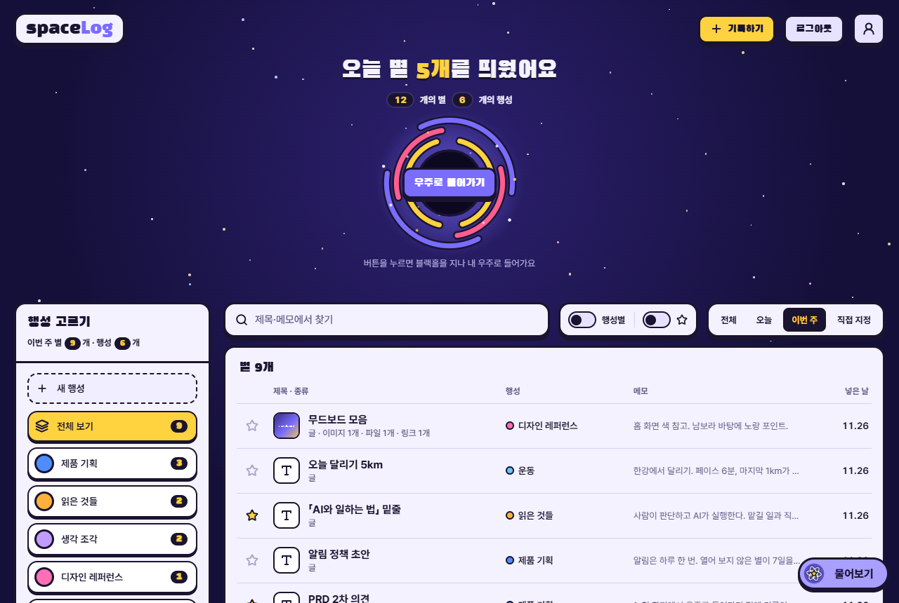

목적: 주소를 열면 처음 보는 화면. 오늘 상태를 확인하고, 기록을 찾아 읽고 고치고, 우주로 들어간다.

배치: 가운데 정렬, 최대 너비 1240px. 위에서 아래로 **상단 줄 → 인사 · 블랙홀 → (왼쪽) 행성 패널 280px + (오른쪽) 거르기 줄과 별 목록**. 블랙홀과 아래 영역 사이는 48px 띄운다(보는 부분과 조작하는 부분의 경계).

**상단 줄**

| 요소 | 내용 | 누르면 |
|---|---|---|
| 로고 | "spaceLog" 카드 | 없음(좁은 화면에서는 행성 서랍 열기) |
| 우주로 들어가기 | 보라 버튼 + 토성 그림. **블랙홀이 화면 밖으로 나갔을 때만** 나타난다 | 맨 위로 올라가 블랙홀 전환 |
| 기록하기 | 노랑 버튼 + plus | 기록하기 창 |
| 로그아웃 | 고스트 버튼 | 로그인 전 화면으로 |
| 계정 | 사람 아이콘 버튼 | 계정 설정 창 |

- 스크롤하면 상단 줄은 위에 붙고(sticky), 화면 폭 전체에 어두운 띠(`rgba(21,16,58,.94)`)와 잉크 밑줄이 깔린다.

**인사 · 블랙홀**

| 요소 | 내용 |
|---|---|
| 인사 | "오늘 별 N개를 띄웠어요"(N은 노랑). 늘 오늘 기준이다(아래 목록의 기간과 상관없다) |
| 개수 | 전체 별 N개 · 행성 N개 배지 |
| 블랙홀 | 210px 원(좁은 화면 180px), 그 위에 보라 "우주로 들어가기"(16px). 누르면 블랙홀 전환 → 우주의 조망 |
| 안내 | "버튼을 누르면 블랙홀을 지나 내 우주로 들어가요" |

**행성 패널(왼쪽)**

| 요소 | 내용 | 누르면 |
|---|---|---|
| 제목 · 요약 | "행성 고르기", "이번 주 별 N개 · 행성 N개"(기간에 따라 "전체 별" · "오늘 별" · "이번 주 별" · "이 기간 별") | 없음 |
| 새 행성 | 점선 테두리 줄(2px `--row-line` 연보라 점선, 옅은 연보라 바탕) + plus. 목록 맨 위 고정. 올림 `--hover` | 행성 꾸미기 창(새 행성) |
| 전체 보기 | layers 아이콘 · 기간 안의 전체 별 수 | 모든 행성의 별을 보인다 |
| 행성 줄 | 색 점 · 이름 · **기간 안의 별 수**. 0개면 흐리게(4-7). 고른 줄은 노랑. 맨 위는 늘 "미분류"(슬레이트색 점, ⋯ 없음, 아래 W-02) | 오른쪽 목록이 그 행성의 별만 보인다(우주로 날아가지 않는다) |
| ⋯ | 행성 줄마다(미분류 제외, 5-6) | 꾸미기 · 지우기 |

- 스크롤해도 화면에 붙어 있다(sticky). 행성이 많으면 패널 안에서 세로 스크롤.

**거르기 줄**

| 요소 | 내용 |
|---|---|
| 검색 | "제목·메모에서 찾기". **지금 고른 행성 · 기간 안에서** 찾는다. 찾은 낱말은 노랑으로 강조. 범위 밖에도 맞는 별이 있으면 목록 위에 "다른 행성·기간에 N개 더 있어요 [전체에서 찾기]" |
| 행성별로 묶기 | 스위치. "전체 보기"일 때만 보인다. 켜면 행성별 머리줄로 나눈다 |
| 자주 찾음만 | 스위치(☆ 아이콘). 켜면 ☆를 켠 별만 |
| 기간 바 | 전체 · 오늘 · 이번 주 · 직접 지정. **우주의 기간과 같은 값이다**: 홈에서 바꾸면 우주도 바뀐다 |

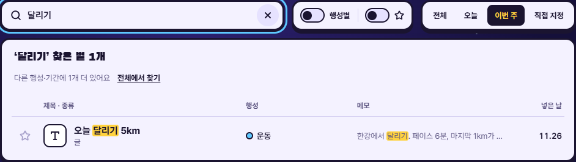

**별 목록**

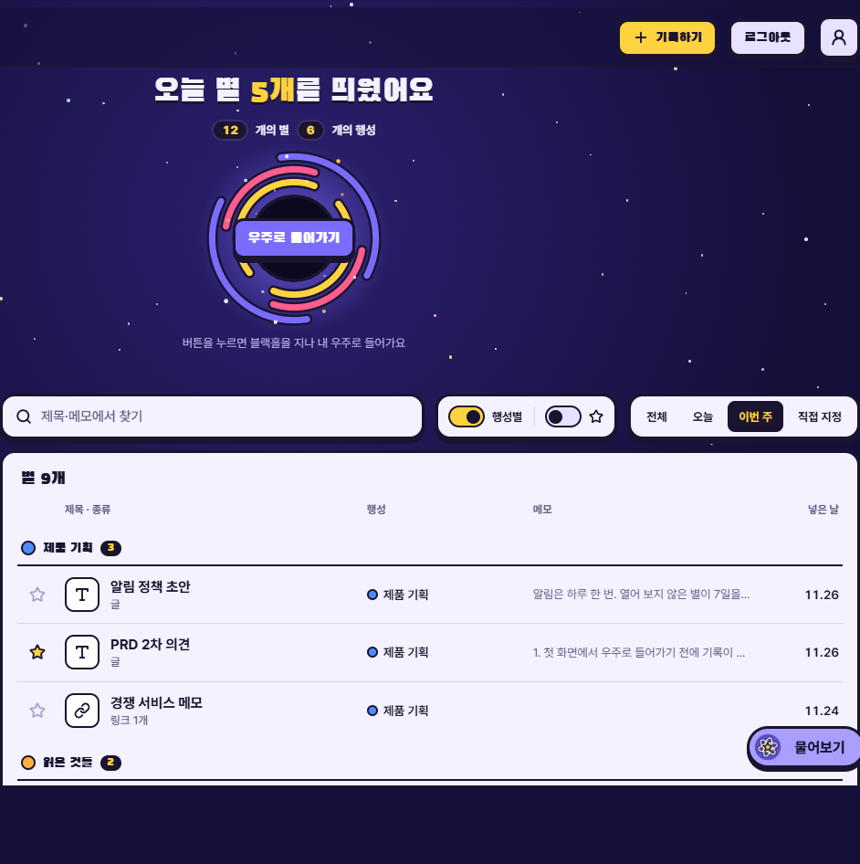

| 칸 | 내용 | 누르면 |
|---|---|---|
| ☆ | 자주 찾음. 켜면 노랑으로 채운다 | 켜고 끄기(서버에 저장) |
| 제목 · 종류 | 썸네일 38px + 제목(굵게) / 종류("글", "링크 1개", "글 · 이미지 1개 · 파일 1개") | 그 자리에 별 상세 |
| 행성 | 색 점 + 이름 | 없음 |
| 메모 | 메모 첫 줄(흐리게). 검색 중이면 찾은 낱말 둘레의 한 줄 | 없음 |
| 넣은 날 | `11.26` | 없음 |
| ⋯ | 줄마다(5-6). 마우스를 올리면 날짜 자리에 | 행성 옮기기 · 지우기 |

- 맨 위 개수 제목 줄 오른쪽에 고스트 버튼 "여러 개 고르기"(아래 W-02 "여러 개 고르기"와 같은 모드). 고르기 중에는 ☆ 칸이 체크칸이 되고(머리의 ☆ 자리에는 모두 고르기 체크칸), 제목 · 상세 열기는 막힌다. 우주로 들어가거나 로그인 · 로그아웃하면 고르기가 끝난다.
- 맨 위에 개수 제목: "별 9개", "제품 기획 · 별 3개", "‘달리기’ 찾은 별 2개".
- 최신순. 한 번에 50개를 보이고 "더 보기 (N개 남음)"으로 50개씩 늘린다.
- "자주 찾음만" 보는 중에 ☆를 끄면 그 줄을 바로 빼지 않고 흐리게 남긴다. 거르기를 바꾸면 그때 빠진다. 까닭: 잘못 눌렀을 때 다시 켤 수 있어야 한다.

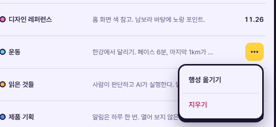

**별 상세(목록 자리에 펼쳐진다)**

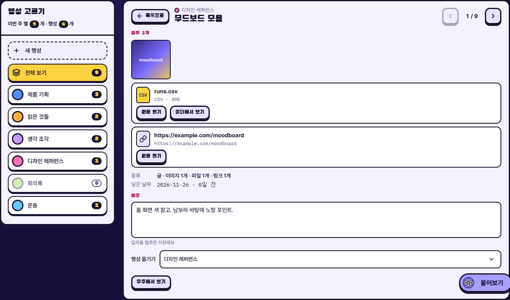

- 별 제목을 누르면 목록 자리에 상세가 펼쳐진다. 거르기 줄과 목록은 숨고, 왼쪽 행성 패널은 그대로다.
- 머리: `[← 목록으로] 행성 이름 · 제목 ··· [<] n / N [>]`. 이전 · 다음은 목록에 보이던 순서를 따른다. 키보드 ←/→로도 넘긴다(글을 쓰는 칸에서는 받지 않는다).
- 내용은 W-03과 같다. 맨 아래 줄 맨 앞에 고스트 "우주에서 보기"가 더 있다: 블랙홀 전환 뒤 그 별로 날아간다.
- "목록으로" · Esc로 돌아오면 보던 스크롤 자리로 돌아가고 초점은 그 별의 제목에 간다.
- 행성을 옮겼을 때: 그 별이 지금 목록에 남아 있으면 상세에 머물고, 빠지면 목록으로 돌아간다. 지우면 목록으로 돌아간다.
- 상세를 보는 중에 왼쪽에서 행성을 고르면 상세를 닫고 그 행성의 목록을 보인다.

**상태**

| 상태 | 화면 |
|---|---|
| 정상 | 위 그대로 |
| 오늘 0개 | 인사가 "오늘은 아직 별이 없어요" |
| 목록이 비었다: 이 기간 · 행성에 별이 없음 | 목록 자리에 "이 기간에는 별이 없어요 / 기간을 넓히거나 다른 행성을 골라 보세요." + [전체 기간 · 전체 보기로] |
| 목록이 비었다: 찾는 말이 없음 | "‘OO’에 맞는 별이 없어요". 다른 범위에 있으면 "다른 행성·기간에 N개 있어요." + [전체에서 찾기], 어디에도 없으면 "제목·메모에서 찾았어요. 다른 낱말로 찾아보세요." + [검색어 지우기] |
| 목록이 비었다: 자주 찾음 없음 | "자주 찾음으로 표시한 별이 없어요 / 목록의 ☆을 눌러 표시해 보세요." + [자주 찾음만 끄기] |
| 별이 하나도 없음 | **같은 화면이다.** 인사 "OO님, 나만의 우주를 시작해 보세요", 목록 자리에 "아직 별이 없어요 / 파일을 끌어다 놓거나 기록하기를 눌러 첫 별을 띄워 보세요." + 노랑 [기록하기] |
| 로그인 전 | 인사 "나만의 우주를 시작해 보세요", 안내 "기록을 별로 띄워 모아 두는 나만의 우주예요". 상단 줄에는 [로그인]만, 아래 영역은 숨긴다. "우주로 들어가기"를 누르면 말풍선 "로그인하면 내 우주로 들어갈 수 있어요 [로그인]" |
| 연결 끊김 | 로고만 남기고 가운데 카드 "spaceLog 서버와 연결이 끊겼어요. 서버를 다시 켜고 새로고침해 주세요." + [새로고침]. 다시 연결되면 고른 행성 · 검색어가 그대로 남는다 |
| 보던 별이 사라짐 | 상세를 닫고 목록으로 |

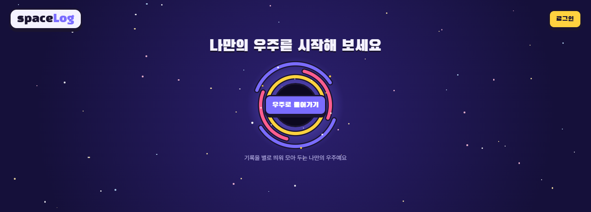

**좁은 화면(760px 이하)**

| 목록 | 행성 서랍 | 기간 바 펼침 | 상세 |
|---|---|---|---|
| 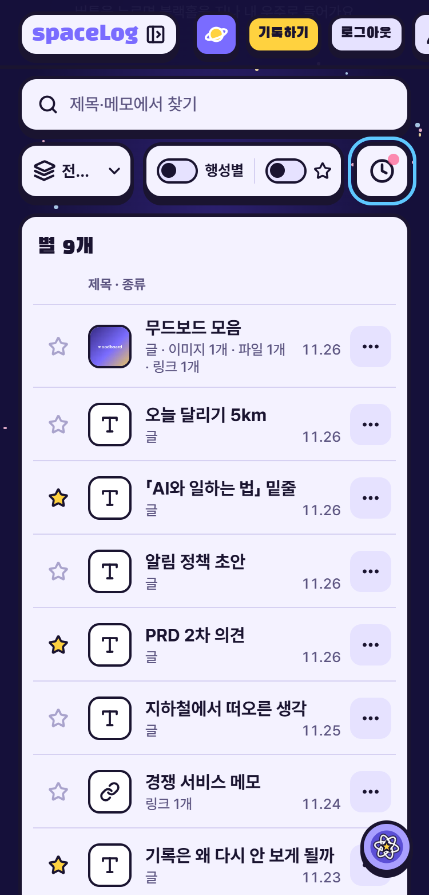 | 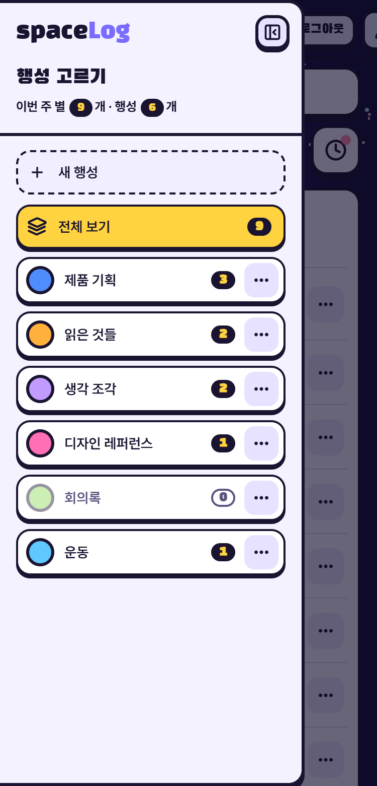 | 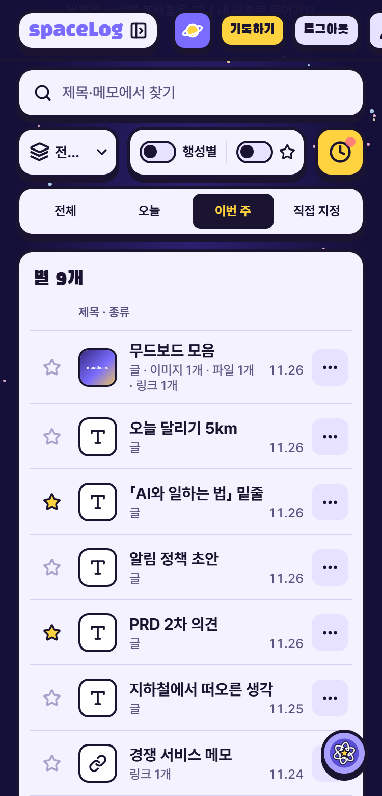 | 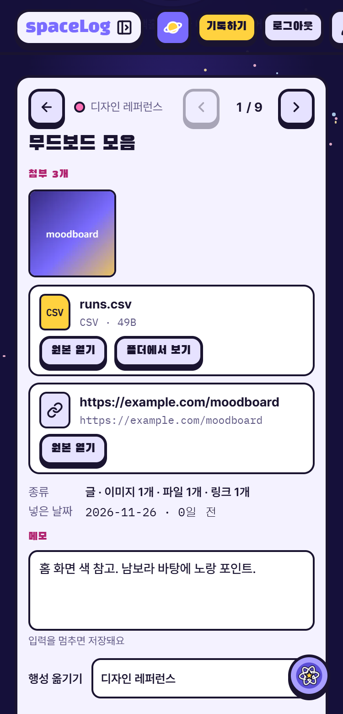 |

- 행성 패널은 서랍이 된다(4-8). 로고 옆 펼치기 아이콘, 거르기 줄의 행성 버튼으로 연다.
- 거르기 줄: `[검색]` 한 줄, 그 아래 `[지금 행성 ▾] [행성별 · ☆] [🕐]`. 기간 바는 🕐를 눌렀을 때만 그 아래에.
- 목록 줄: `[☆] [썸네일] 제목 / 종류 ··· 날짜 [⋯]`. 행성 · 메모 칸은 숨기고, 날짜는 종류와 같은 줄 오른쪽 끝에 둔다. ⋯는 늘 보인다.
- 상세의 머리: "목록으로"는 ← 아이콘만 남고, 제목은 바로 아래 줄 전체에 둔다.
- 상단 줄: 로고 18px, 버튼 13px. "우주로 들어가기"는 아이콘만.

### W-01 우주

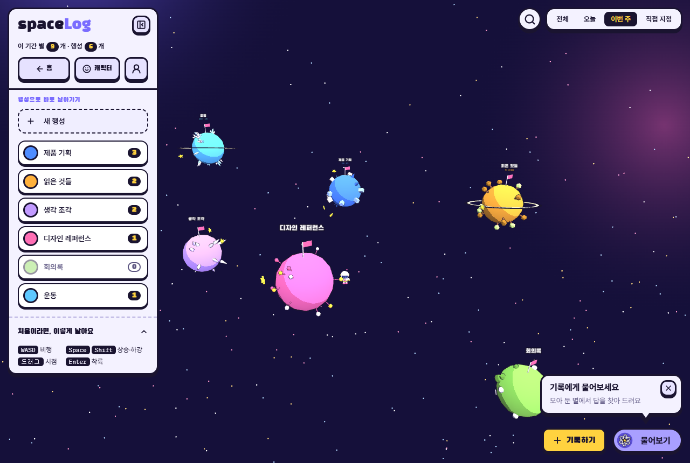

| 위치 | 요소 | 비고 |
|---|---|---|
| 왼쪽 | **왼쪽 패널**(카드, 폭 280px) | 아래 표 |
| 오른쪽 위 | 별 찾기(동그란 버튼) + 기간 바 | 홈의 기간 바와 같은 모양 · 같은 값. 별 상한 띠 배너는 그 아래. 행성 패널 · 챗봇 창이 열린 동안은 위로 숨는다(아래 "위쪽 막대 숨김") |
| 오른쪽 아래 | 기록하기(노랑) + 챗봇 버튼 "물어보기" | 나란히 |
| 아래 가운데 | 토스트 자리, 그 위에 착륙 안내 "Enter 'OO' 행성 열기" | 행성 가까이 있을 때 |
| 오른쪽 | 행성 패널(W-02) | 열렸을 때 |

**왼쪽 패널**

| 영역 | 내용 |
|---|---|
| 머리 | "spaceLog" 로고, 오른쪽에 접기 버튼 |
| 요약 | "이 기간 별 N개 · 행성 N개", 고스트 버튼 세 개: [← 홈] [캐릭터] [사람 아이콘: 계정 설정 · 로그아웃 메뉴] |
| 행성 목록 | 라벨 "행성으로 바로 날아가기". 맨 위에 "새 행성"(고정), 그 아래 행성 줄(세로 스크롤, **"미분류"가 맨 위**). 지금 가까운 행성은 연한 노랑(`--sel`) + 잉크 테두리, 0개면 흐리게. 줄마다 ⋯(꾸미기 · 지우기, 미분류는 없음) |
| 조작 안내 | 접히는 줄 "처음이라면, 이렇게 날아요". 처음엔 펼쳐져 있고 이동 키를 한 번 누르면 접힌다. 터치 화면에서는 "행성을 누르면 날아가요 · 끌어서 둘러보기" 한 줄 |

- 홈의 행성 줄과 모양이 같지만 누르면 하는 일이 다르다: **홈에서는 목록을 거르고, 우주에서는 그 행성으로 날아간다.**
- 접으면 왼쪽 위에 로고가 든 작은 버튼만 남는다. 접기 상태는 브라우저에 기억한다.
- 패널 위에서는 끌기 · 휠이 우주로 넘어가지 않는다.

**모드**

| 모드 | 카메라 | 바뀌는 조건 |
|---|---|---|
| 조망(기본) | 우주 가운데를 보고 멀리서. 모든 행성이 한 화면에 | 들어올 때 |
| 비행 | 캐릭터 뒤 | 이동 키를 누르면 |
| 자동 비행 | 진행 방향 뒤로 천천히 돈다 | 목록 · 찾기 결과 · 챗봇 출처 · 홈의 "우주에서 보기" |

**상태**

| 상태 | 화면 |
|---|---|
| 정상 | 위 그대로 |
| 오늘 0개 | 기간을 이번 주로 넓히고 토스트 "오늘 별이 없어 이번 주를 보여드려요" |
| 별이 하나도 없음 | 기록하기 버튼 위에 말풍선 "아직 별이 없어요 / 기록하기를 누르거나 파일을 끌어다 놓아 보세요"(✕로 끄면 다시 나오지 않는다). 그동안 기록하기 둘레에 느리게 번지는 테두리 |
| 별 상한 초과(기간 안 2,000개 초과) | 별은 그리지 않고 행성 · 개수만. 기간 바 아래 띠 배너 "기간을 좁히면 별이 보여요 [오늘만 보기]" |
| 기간 밖의 별로 날아갈 때 | 기간은 그대로 두고 그 별 하나만 핑크로 잠시 보인다. 토스트 "N일 전 별이라 이 별만 잠시 보여드려요". 그 별의 상세를 벗어나면 다시 숨는다 |
| 불러오는 중 | 블랙홀 전환의 기다림 단계에서 고리가 돈다(9장) |
| 연결 끊김 | 가운데 카드(홈과 같은 문구) |

**위쪽 막대 숨김**(`topbar.js`): 행성 패널 또는 챗봇 창이 하나라도 열려 있으면 별 찾기 · 기간 바 · 검색 줄 · 띠 배너가 함께 0.2초 동안 위로 미끄러져 숨고(모션 줄이기면 바로), 두 창의 위 끝이 화면 위에서 28px까지 올라가 창이 늘어난다(아래 끝은 그대로). 둘 다 닫히면 막대가 제자리로 내려온다.

- 숨은 동안 위 끝에 **손잡이**가 매달린다: 글자 · 아이콘 없는 노랑 홈(64×17px, 좌우 · 아래 3px 잉크 테두리, 아래 모서리만 둥글게, 3px 단색 그림자). 가로 자리는 오른쪽 맨 끝 창(챗봇 창 또는 행성 패널)의 가운데라 창의 ✕를 가리지 않는다. 마우스를 올리거나 키보드로 오면 23px로 길어지고 아래에 "검색 · 기간" 작은 말풍선(잉크 바탕)이 뜬다. 누르는 자리는 96×28px(창 위 끝에서 멈춰 창 안으로 들어가지 않는다). `aria-label` "검색과 기간 펼치기", `aria-expanded`.
- 누르면 막대가 창 위에 겹쳐 내려오고(창 크기는 그대로) 손잡이는 숨는다. 대신 막대 줄의 오른쪽 끝에 위 화살표 버튼("검색과 기간 접기")이 생긴다.
- 다시 접히는 때: 접기(위 화살표)를 누를 때, 기간(전체 · 오늘 · 이번 주)을 고른 뒤("직접 지정"은 날짜를 고르게 남긴다), 막대 · 손잡이 · 검색 목록 밖을 누를 때, Esc. 검색 줄이 열려 있으면 밖을 눌러도 접지 않고 검색을 닫으면 접힌다.
- 검색 결과 목록("최근 별" 포함)은 행성 패널 · 챗봇 창 · 손잡이보다 위에 뜬다.
- 좁은 화면도 같다(홈은 막대가 있던 오른쪽 끝). 다만 챗봇 창은 전체 화면이라 열린 동안 손잡이를 두지 않고, 행성 패널은 로고 버튼 줄 아래부터 쓴다. 서랍이 펼쳐진 동안도 손잡이는 숨는다.

**좁은 화면**: 왼쪽 패널은 서랍, 오른쪽 위는 `[찾기] [🕐 지금 기간]`이고 🕐를 누르면 기간 바가 아래 줄에 펼쳐진다. 찾기는 전체 화면으로 열린다. 행성 패널은 아래에서 올라오는 시트(높이 62%).

### W-02 행성 패널

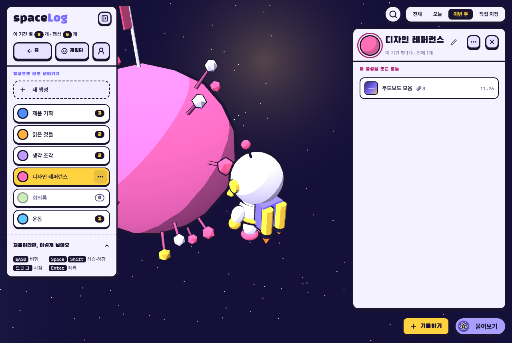

오른쪽에서 열리는 패널. 너비 380px. 열린 동안 위쪽 막대가 숨으므로 화면 위 끝에서 28px 떨어진 곳에서 시작하고(좁은 화면은 로고 버튼 줄 아래) 아래는 84px을 비운다(기록하기를 가리지 않게). 행성에 착륙하거나 왼쪽 목록으로 날아가 도착하면 열린다. **별 상세는 이 패널의 목록 줄에서만 연다**(우주에서 별을 눌러 열지 않는다).

| 영역 | 요소 | 누르면 |
|---|---|---|
| 머리 | 행성 색 원 46px, 이름(display 24px) + ✎, "오늘 별 N개 · 전체 M개"(앞은 지금 기간: 오늘 · 이번 주, 직접 지정이면 실제 날짜 "11.20–11.26"(하루면 "11.20"). 막대가 숨어도 무엇으로 걸렀는지 보이게. 누르는 기능은 없다. 전체 기간이면 "전체 별 M개"), ⋯, ✕ | ✎ 행성 꾸미기 창 / ⋯ 메뉴 / ✕ 닫기(캐릭터와 카메라는 그 자리에 남는다) |
| 메뉴 | 행성 꾸미기 / 다른 행성과 합치기 / 행성 삭제 | 꾸미기 창 / 합칠 행성을 고르는 확인 창 / 행성 지우기 창 |
| 목록 위 | 고스트 버튼 "여러 개 고르기"(보이는 별이 2개 이상일 때. 행성이 하나뿐이어도 보인다: 지우기는 된다) | 고르기 모드(아래) |
| 목록 | 라벨 "이 행성을 도는 별들". 이 기간의 별, 최신순. 썸네일 · 제목 · (첨부가 2개 이상이면 클립 + 개수) · 날짜 | 제목 = W-03. 줄마다 ⋯(행성 옮기기 · 지우기) |

| 상태 | 화면 |
|---|---|
| 이 기간 별 0개 | 목록 자리에 점선 상자 "이 기간에는 이 행성에 별이 없어요. 위쪽에서 기간을 넓혀 보세요." (기간이 전체면 "이 행성에는 아직 별이 없어요.") |
| 행성 1개뿐 | "다른 행성과 합치기" 잠김 |
| 새 별이 들어옴 | 그 줄이 1.2초 핑크 |

- 패널이 열려 있어도 비행 키와 기간 바는 동작한다. 그 행성에서 멀어지면 패널을 닫는다.
- 합치기 확인 창: "별 N개가 'OO'(으)로 옮겨가고 이 행성은 사라져요. 되돌릴 수 없어요." 취소 + 핑크 "합치기".

**미분류 행성**: 분류를 귀찮아하는 사람을 위한 기본 행성. 행성을 고르지 않고 저장한 별이 여기 모인다. 늘 있고 이름 · 설명 · 모습을 바꾸거나 지우거나 다른 행성으로 합칠 수 없다(다른 행성을 미분류로 합치는 것은 된다).

- 머리의 ✎ · ⋯가 없고, 머리 아래에 한 줄 "기본 행성이라 이름을 바꾸거나 지울 수 없어요".
- 행성 색 원은 슬레이트색(`#4c5b6b`). 색을 쓰는 모든 곳(점, 원, 선택 칸)에서 같다.
- 행성이 나오는 모든 목록 · 선택 칸에서 맨 위에 둔다.

**여러 개 고르기**: 홈 별 목록과 우주 패널이 같은 부품 · 같은 문구를 쓴다.

| 단계 | 화면 |
|---|---|
| 시작 | "여러 개 고르기"를 누른다. 줄마다 체크칸이 생기고, 줄을 누르면 체크된다(상세는 열리지 않는다). 버튼은 "취소"가 된다 |
| 모두 고르기 | 머리에 체크칸 하나(✓ 모두 / − 일부 / 빈칸, 읽는 이름 "보이는 별 모두 고르기"). 누르면 보이는 줄을 모두 고르고, 다시 누르면 모두 비운다. 홈은 ☆ 칸 머리에 있고 "취소"는 오른쪽, 우주 패널은 목록 라벨 줄 왼쪽에 있고 "취소"는 오른쪽이다 |
| 고르는 중 | 목록 아래에 바 "N개 골랐어요" + 노랑 "행성 옮기기" + 흰 "지우기"(글자는 위험색 `--danger-text`). 0개면 둘 다 잠긴다. 옮길 행성이 없으면(고른 별이 모두 한 행성이고 다른 행성이 없다, 예: 미분류뿐) "행성 옮기기"만 잠기고 "지우기"는 된다 |
| 옮길 행성 | 확인 창 "N개를 어느 행성으로 옮길까요?" + 행성 선택 + 취소 · "N개 옮기기" |
| 지우기 | 확인 창 "N개를 지울까요?" + 설명 + 취소 · 핑크 "N개 지우기". 설명은 보관함 복사본이 있으면 "기록과 첨부 파일 N개의 보관함 복사본이 함께 지워져요. 되돌릴 수 없어요.", 없으면 "기록 N개가 지워져요. 되돌릴 수 없어요.", 개수를 셀 수 없으면 "기록 N개와 첨부 파일의 보관함 복사본이 함께 지워져요. 되돌릴 수 없어요." |
| 끝 | 토스트 "N개를 'OO'(으)로 옮겼어요"(서버가 옮긴 개수). 모두 이미 그 행성에 있었다면 "이미 그 행성에 있어요". 지웠으면 "N개를 지웠어요", 0개면 "그 별들은 이미 지워졌어요". 일부만 됐으면 "N개는 옮겼고(지웠고) 나머지는 옮기지(지우지) 못했어요". 실패하면 "옮기지 못했어요" · "지우지 못했어요. 다시 눌러 주세요". 고르기는 끝난다 |

- "보이는 별" = 홈은 지금 거르기 · 검색 아래 이미 불러온 줄("더 보기"로 늘린 것 포함), 우주는 패널 목록.
- 바는 760px 이하와 우주 패널에서 늘 두 줄이다: 위에 개수, 아래에 두 버튼이 반반 너비로(높이 44px 이상).
- 고르는 동안(`body.picking`) 채팅 "물어보기" 버튼과 말풍선을 숨긴다. 채팅 패널을 닫으면 초점이 고르기 바(없으면 모두 고르기 칸)로 간다.
- Esc로도 끝난다(4-9). 홈의 고르기는 우주로 들어갈 때와 로그인 · 로그아웃 때도 끝난다. 목록이 다시 그려져 사라진 별은 선택에서 빠지고, 남은 것은 유지된다.
- 우주에서는 옮긴 별(먼지)이 새 행성으로 날아가 별이 된다.

### W-03 별 상세

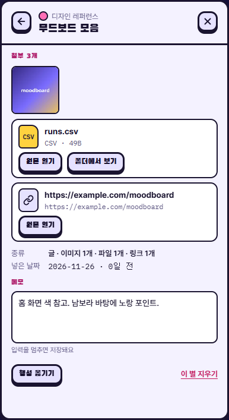

별 하나를 읽고 고치는 화면. **홈과 우주가 같은 코드 · 같은 내용을 쓰고, 머리만 다르다.**

| | 우주(W-02 패널 안) | 홈(목록 자리) |
|---|---|---|
| 머리 | ← · 행성 색 점 + 이름 · 제목(19px) · ✕ | ← 목록으로 · 행성 색 점 + 이름 · 제목(22px) · 이전 · n / N · 다음 |
| 맨 아래 | 행성 옮기기 ··· 이 별 지우기 | 우주에서 보기 · 행성 옮기기 ··· 이 별 지우기 |
| 옮긴 뒤 | 원래 행성의 목록으로 | 목록에 남아 있으면 그대로 |

| 영역 | 요소 |
|---|---|
| 첨부 | 라벨 "첨부 N개". 이미지는 축소본 격자(누르면 그 자리에서 크게 보기, Esc · 닫기로 닫는다). 파일은 확장자 아이콘 · 이름 · "PDF · 1.2MB" · [원본 열기] [폴더에서 보기]. 링크는 제목 · 주소 · [원본 열기] |
| 정보 | 종류("글 · 이미지 1개 · 파일 1개 · 링크 1개", 있는 것만), 넣은 날짜 "2026-11-26 · 0일 전" |
| 메모 | 별의 글(본문)을 보여 주고 고치는 칸. 안내 글 "이 별에 남길 말". 3줄에서 시작해 화면 높이의 40%까지. 2만 자까지, 1만 8천 자부터 "18,200 / 20,000". 입력을 멈추고 0.6초 뒤 저장. 아래에 "입력을 멈추면 저장돼요 → 저장 중… → 저장됨" |
| 아래 줄 | 왼쪽에 고스트 버튼, 오른쪽 끝에 지우기. 홈: [우주에서 보기] [행성 옮기기], 우주: [행성 옮기기] |
| 행성 옮기기 | 버튼 → 확인 창에서 행성을 고르고 [옮기기](목록 ⋯ 메뉴와 같은 창). 고르는 것만으로는 옮겨지지 않는다. 옮기면 토스트 "'OO'(으)로 옮겼어요". 행성이 하나뿐이면 버튼이 없다 |
| 지우기 | 글자 링크 "이 별 지우기" → 확인 창 |

- 원본 파일은 편집하지 않는다. 이 화면에서 바뀌는 것은 메모와 행성뿐이다.
- 메모를 쓰다가 떠나면(목록으로, 다음 별, 패널 닫기, 창 닫기) 그때 바로 저장한다.
- 크게 보기는 넓은 자리에서도 폭 560px까지만 커진다.
- 값을 모르면(파일 크기 등) 회색으로 "크기 미확인"이라고 쓴다.

### 기록하기 창

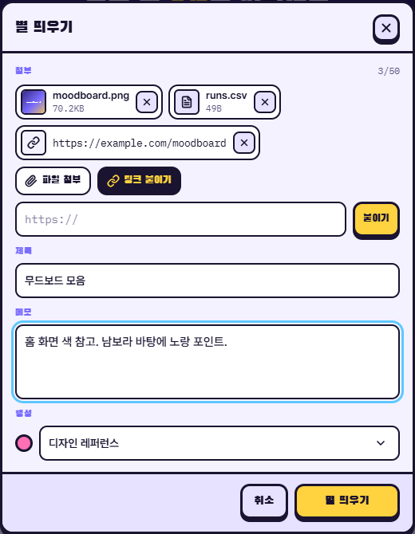

글 + 첨부 파일 + 링크를 저장하면 **별 하나**가 된다. 홈 · 우주의 "기록하기", 파일을 화면에 끌어다 놓기, 붙여넣기(Ctrl+V), 챗봇 답의 "별로 저장"으로 연다.

| 영역 | 요소 |
|---|---|
| 머리 | "별 띄우기", ✕ |
| 첨부 | 라벨 "첨부"(오른쪽에 "2/50") → 담긴 칩 → 가벼운 버튼 [파일 첨부] [링크 붙이기]. 비어 있으면 옆에 "파일을 끌어다 놓아도 돼요". 링크 붙이기를 누르면 주소 한 줄 + [붙이기] |
| 첨부 칩 | 파일: 축소본 또는 아이콘 · 이름 · 크기 · ✕. 링크: 아이콘 · 주소 · ✕ |
| 제목 | 한 줄, 비워도 된다. 비우면 쓰일 제목을 안내 글로 미리 보인다: "비워 두면 “runs”". 순서는 메모 첫 줄(40자) → 첫 파일 이름 → 첫 링크 |
| 메모 | 별의 글. 3줄에서 시작해 늘어난다 |
| 행성 | 색 점 + 선택 상자. 맨 아래 "+ 새 행성 만들기"를 고르면 바로 아래에 이름 칸(20자까지, 필수) |
| 발 | (잠긴 까닭 안내) · 취소 · 노랑 "별 띄우기" |

- **별 띄우기는 메모나 첨부 중 하나라도 있고 행성이 정해졌을 때** 누를 수 있다. 잠겨 있으면 버튼 위에 까닭을 보인다(4-4): "메모를 쓰거나 파일·링크를 넣으면 띄울 수 있어요" → "새 행성 이름을 적으면 띄울 수 있어요".
- 행성 기본값: 열려 있는 패널의 행성 → **미분류**. "마지막으로 저장한 행성"은 쓰지 않는다(고르지 않으면 미분류에 모인다). 선택 상자 맨 위가 미분류다.
- 주소는 `http://` · `https://`로 시작해야 한다. 아니면 칸 아래 빨간 글 "주소는 http로 시작해야 해요".
- 한도: 첨부 50개, 파일 하나 500MB, 메모 2만 자. 넘는 것은 빼고 토스트로 알린다.
- 띄우는 중에는 버튼이 "띄우는 중… 42%"로 바뀐다(색은 그대로). 파일을 올리는 동안 취소는 "올리기 멈추기"가 된다.
- 성공하면 창이 닫히고 토스트 "별을 띄웠어요". 우주라면 새 별이 솟아 그 행성 궤도로 들어간다.
- 실패하면 창을 닫지 않고 발 위에 빨간 글. 쓴 내용은 그대로 둔다.
- 쓰던 내용이 있을 때 닫으려 하면 확인 창 "쓰던 기록을 버릴까요? / 입력한 내용이 사라져요." 취소 + 핑크 "버리기".
- 파일을 화면 위로 끌고 오면 잉크색 반투명 막 + 점선 카드 "여기에 놓으면 별이 돼요"가 뜬다.

### 행성 꾸미기 창 · 행성 지우기 창

| 새 행성 만들기 | 행성 지우기 |
|---|---|
| 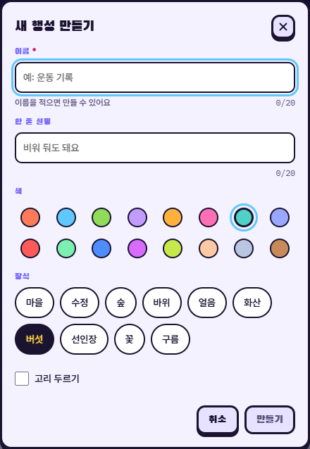 | 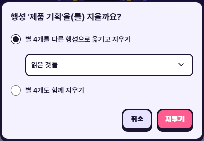 |

**행성 꾸미기 창.** 새 행성을 만들 때와 있는 행성을 고칠 때 같은 창을 쓴다. 제목만 "새 행성 만들기" / "행성 꾸미기", 확정 버튼만 "만들기" / "저장하기"로 다르다.

| 영역 | 요소 |
|---|---|
| 이름 | **필수(*)**. 20자까지, 아래에 "n/20". 비어 있으면 아래에 "이름을 적으면 만들 수 있어요" |
| 한 줄 설명 | 20자까지, 비워도 된다. 우주에서 행성 이름표 둘째 줄에 보인다 |
| 색 | 색 원 16개(8개씩 2줄) |
| 장식 | 칩 10개: 마을 · 수정 · 숲 · 바위 · 얼음 · 화산 · 버섯 · 선인장 · 꽃 · 구름 |
| 고리 | 체크박스 "고리 두르기". **기본은 꺼짐** |

- 새로 만들 때 색 · 장식은 만든 순서대로 미리 골라져 있다(색은 1번부터, 장식은 표 순서대로). 고리는 사용자가 직접 켠다.
- 이름이 비었거나 20자를 넘으면 확정 버튼이 잠긴다(회색).
- 여는 곳: 홈 · 우주의 "새 행성", 행성 줄의 ⋯ → 꾸미기, 행성 패널의 ✎ · 메뉴.
- 토스트: "행성 'OO'을(를) 만들었어요" / "행성을 꾸몄어요".

**행성 지우기 창.** 별이 있는지, 다른 행성이 있는지에 따라 세 가지다.

| 경우 | 창 |
|---|---|
| 별 0개 | "행성 'OO'을(를) 지울까요?" / "되돌릴 수 없어요." |
| 별 있음 · 다른 행성 있음 | 고르기 2개: "별 N개를 다른 행성으로 옮기고 지우기"(기본, 아래에 옮길 행성 선택 상자) / "별 N개도 함께 지우기"(고르면 선택 상자가 잠기고 경고가 나온다) |
| 별 있음 · 행성이 이것 하나뿐 | "별 N개의 기록과 보관함 복사본이 함께 지워져요. 되돌릴 수 없어요." |

- N은 기간과 상관없이 그 행성의 전체 별 수다.
- 토스트: "행성 'OO'을(를) 지웠어요" / "별 N개를 'XX'(으)로 옮기고 지웠어요".

**별 지우기 · 옮기기 확인 창**(5-4의 확인 창)

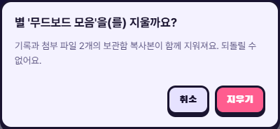

### 캐릭터 꾸미기 창

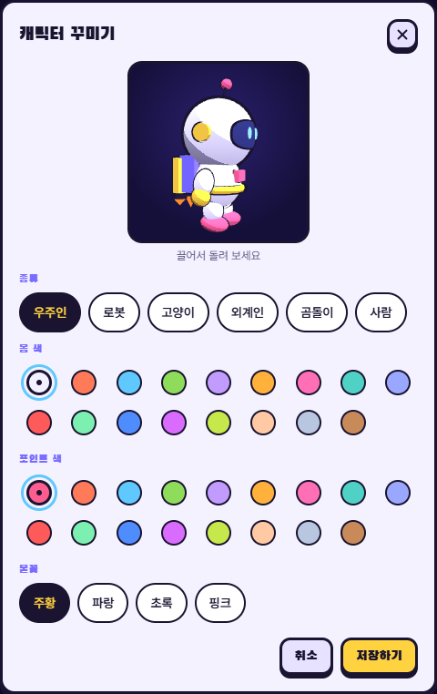

우주 왼쪽 패널의 "캐릭터"로 연다. 행성 꾸미기 창과 같은 모양 · 같은 키보드 규칙이다.

| 영역 | 요소 |
|---|---|
| 미리보기 | 고른 모습의 캐릭터 3D. 끌어서 돌려 본다. 고를 때마다 바로 바뀐다 |
| 종류 | 칩 6개: 우주인 · 로봇 · 고양이 · 외계인 · 곰돌이 · 사람 |
| 몸 색 · 포인트 색 | 색 원 17개씩("기본" + 행성 색 16가지) |
| 불꽃 | 칩 4개: 주황(기본) · 파랑 · 초록 · 핑크 |

- 저장하면 우주의 캐릭터가 그 자리에서 바뀐다. 토스트 "캐릭터를 꾸몄어요".

### 별 찾기(우주)

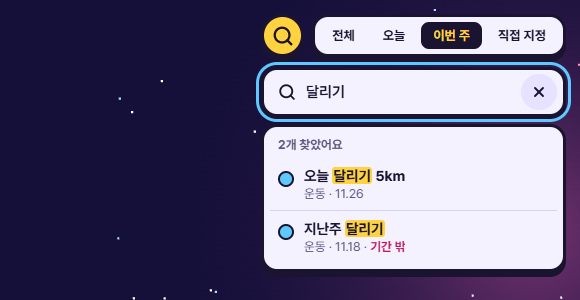

- 오른쪽 위의 동그란 찾기 버튼을 누르면 기간 바 아래에 검색 줄이 펼쳐지고, 결과가 그 아래에 뜬다.
- **모든 기간의 별**에서 제목 · 메모를 찾는다(홈의 검색은 고른 범위 안에서 찾는다. 우주에는 목록이 없어 범위를 정할 수 없기 때문이다).
- 결과 줄: 행성 색 점 · 제목(찾은 낱말 강조) · 행성 이름 · 날짜. 지금 기간 밖의 별이면 "기간 밖"을 붙인다. 최신순 30개까지.
- 검색어가 비어 있으면 최근 별 5개를 보인다.
- 결과를 누르면 그 별로 날아가 상세를 연다. 기간 밖이면 그 별 하나만 잠시 보인다.
- 좁은 화면에서는 전체 화면으로 열린다(←로 닫는다).

### 챗봇

| 처음 화면 | 답 |
|---|---|
| 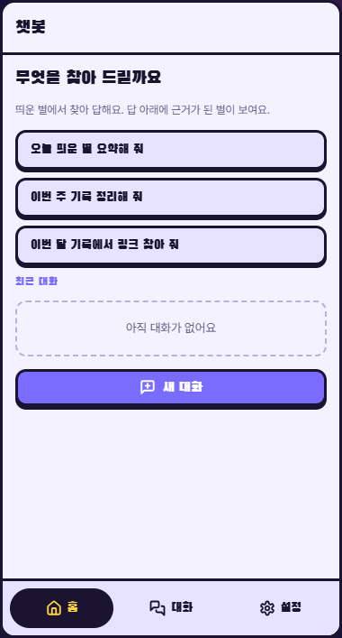 | 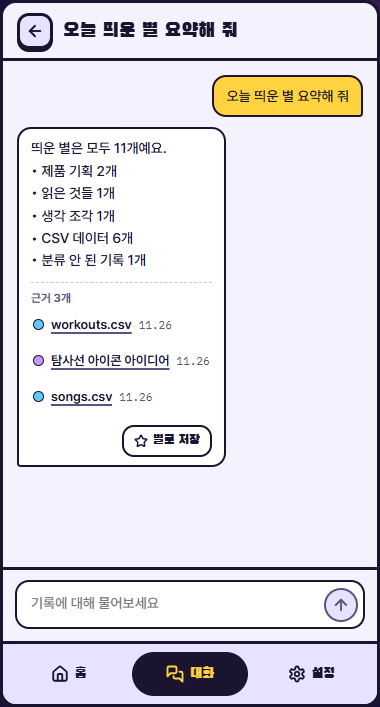 |

**버튼.** 화면 오른쪽 아래 맨 구석, 홈과 우주 모두. 보라 알약에 원자 그림(가운데 노란 별, 흰 궤도) + "물어보기". 좁은 화면에서는 잠깐 알약으로 보였다가 둥근 버튼으로 줄어든다. 읽지 않은 답이 있으면 빨간 점.

**창.** 버튼 위로 열리는 카드, 폭 380px, 높이 최대 화면의 75%. 좁은 화면에서는 화면 전체. 아래 탭 세 개.

| 탭 | 내용 |
|---|---|
| 홈 | 인사말, 바로 누르는 질문 버튼("오늘 띄운 별 요약해 줘", "이번 주 기록 정리해 줘", 행성 패널이 열려 있으면 "'OO' 행성 요약해 줘"), 최근 대화 |
| 대화 | 지난 대화 목록(제목 · 시각 · 지우기), "새 대화" |
| 설정 | 챗봇 켜기 · 끄기, 빼 둘 행성, 챗봇이 읽은 기록 수와 다시 읽기, OpenAI 안내 |

**대화.** 내 말은 노랑 말풍선(오른쪽), 답은 흰 말풍선(왼쪽). 답 아래에 **근거**(행성 색 점 · 별 제목 · 날짜)와 "별로 저장".

- 근거를 누르면 그 별로 날아가 상세를 연다. 홈에서 눌렀으면 블랙홀 전환 뒤에 날아간다.
- "별로 저장"은 기록하기 창을 연다(메모 칸에 그 답). 저장한 뒤에는 "띄운 별 보기"로 바뀐다.
- 입력칸: Enter로 보내기(한글 조합 중에는 보내지 않는다), Shift+Enter 줄바꿈. 답이 나오는 동안 보내기 버튼은 멈추기가 된다.
- **처음 켤 때**: "챗봇을 켜면 질문에 필요한 기록 내용이 OpenAI로 보내져요."와 빼 둘 행성 목록, 취소 · 켜기. 켜기 전에는 이 안내만 보인다.

### 로그인 · 계정

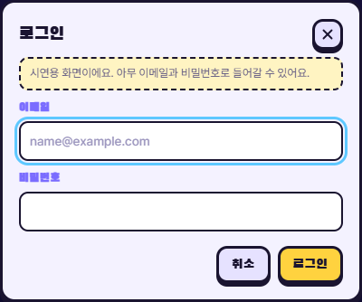

시연용이다. 아무 이메일과 비밀번호로 들어간다. 꾸미기 창과 같은 모양(최대 400px).

- 로그인 전에는 기록과 관련된 것을 모두 숨긴다(목록, 기록하기, 챗봇).
- 계정 설정: 우주선장 이름(홈 인사말에 쓴다, 20자), 로그인한 계정, 비밀번호 변경.
- 여는 곳: 홈 상단 줄의 사람 아이콘, 우주 왼쪽 패널의 사람 아이콘 메뉴(계정 설정 · 로그아웃).

---

## 7. 화면에 필요한 데이터

화면이 서버에서 받는 모양이다. 한도 · 저장 방식 · 옮기기 같은 서버 동작은 `docs/superpowers/specs/`의 스펙 문서를 본다. 화면에서 쓰는 요청은 모두 `web/src/api.js`에 있다.

### 별

| 필드 | 예 | 쓰는 곳 |
|---|---|---|
| id | `c098a897-…` | 전부 |
| title | "PRD 2차 의견" | 전부. 비면 "제목 없음"이라고 보인다 |
| body | 별의 글. 화면에서는 **"메모"**라고 부른다(2만 자까지). 없으면 `null` | 상세의 메모 칸, 목록의 메모 줄, 검색 |
| fav | `true` · `false`. 자주 찾음(☆) | 홈 목록 |
| planet_id | 행성 id | 전부 |
| created_at | `2026-11-26T01:04:55.273Z`(넣은 시각) | 날짜, 기간, "N일 전" |
| type | `text` · `image` · `link` · `file`. 계산한 값이다: 첨부가 없으면 `text`, 있으면 첫 첨부의 종류 | 목록의 썸네일 아이콘 |
| attachments | 첨부 목록(아래) | 상세, 목록의 종류 |
| attachment_count | 3 | 패널 목록의 클립 개수 |
| has_thumb · thumb_attachment_id | 축소본이 있는지, 어느 첨부의 것인지 | 목록 썸네일 |
| memo | 쓰지 않는다(옛 메모는 body에 합쳤다. 칸만 남아 있다) | 없음 |

**첨부**: id, kind(`image` · `file` · `link`), position(순서), file_name · file_ext · file_size, url · link_title, has_thumb.

### 행성

| 필드 | 예 | 쓰는 곳 |
|---|---|---|
| id · name | id · "제품 기획"(20자까지) | 전부 |
| description | "PRD · 정책"(20자까지, 비워도 된다) | 우주의 이름표 둘째 줄 |
| color_index | 1 ~ 16(3-1 표의 번호) | 색 점, 3D |
| deco | `town` · `crystal` · `forest` · `rock` · `ice` · `volcano` · `mushroom` · `cactus` · `flower` · `cloud` | 3D |
| ring | `true` · `false` | 3D |
| slot | 우주에서의 자리 번호. 미분류는 `-1`(다른 행성은 0 이상) | 3D |
| count_in_period · count_total | 3 · 4 | 행성 줄의 개수(기간 안), 패널 머리, 지우기 창(전체) |

**미분류 행성**은 모든 DB에 켤 때 없으면 만든다: id `unsorted`, 이름 "미분류", 설명 "고르지 않고 저장한 기록", slot `-1`. color_index(1) · deco · ring 값은 화면에 쓰지 않는다. 이름 · 설명 · 모습을 고치거나(`PATCH`), 지우거나, 합치려(`merge`) 하면 서버가 `403 { error: 'locked' }`로 막는다.

### 요약

`{ in_period, total, planets }`: 기간 안의 별 수, 전체 별 수, 행성 수. 홈 인사말(오늘 기준으로 따로 묻는다)과 개수 배지에 쓴다.

### 화면이 쓰는 요청

| 하는 일 | 요청 |
|---|---|
| 기간별 행성 · 별 · 요약 | `GET /api/planets` · `/api/stars` · `/api/summary` (`from`, `to`. 별은 `planet_id`, `limit`, `fav=1`도) |
| 별 하나 | `GET /api/stars/:id` |
| 별 띄우기 | `POST /api/stars`(글 + 파일 + 링크를 한 번에) |
| 메모 저장, 행성 옮기기, 자주 찾음 | `PATCH /api/stars/:id` (`body` · `planet_id` · `fav`) |
| 별 지우기 | `DELETE /api/stars/:id`(기록과 보관함 복사본) |
| 별 여러 개 옮기기 | `POST /api/stars/move` (`{ ids, planet_id }` → `{ moved }`. 있는 별만 옮기고 실제로 옮긴 개수를 돌려준다) |
| 별 여러 개 지우기 | `POST /api/stars/delete` (`{ ids }` → `{ deleted }`. 검사는 옮기기와 같고, 하나씩 지울 때와 똑같이 검색 색인 · 보관함 파일까지 정리한다. 화면은 500개씩 나눠 보낸다. 옮기기도 같다) |
| 행성 만들기 · 꾸미기 · 합치기 · 지우기 | `POST` · `PATCH /api/planets/:id` · `POST …/merge` · `DELETE` |
| 원본 열기 · 폴더에서 보기 · 축소본 | `/api/attachments/:id/open` · `/reveal` · `/thumb` · `/file` |
| 캐릭터 | `GET` · `PUT /api/character` |
| 챗봇 | `/api/chat/…` |
| 연결 확인 | `GET /api/health`(실패하면 연결 끊김 상태) |

- 기간은 홈과 우주가 같은 값을 쓴다(`store.state.period`). 기간을 바꾸면 행성 · 별 · 요약을 한꺼번에 다시 받는다.
- 검색은 서버에 요청하지 않는다. 별을 모두 받아 화면에서 거른다.
- 화면은 저장이 끝나기 전에 먼저 바꾸고(☆, 옮기기, 지우기), 실패하면 되돌리고 토스트로 알린다.

---

## 8. 3D 규격

### 캐릭터
- 2등신 툰 스타일 6종: 우주인(기본) · 로봇 · 고양이 · 외계인 · 곰돌이 · 사람. 모두 잉크 외곽선, 3단 음영, 제트팩과 불꽃, 같은 크기 · 같은 조작감이다.
- 사용자가 종류, 몸 색, 포인트 색, 불꽃 색을 고른다(6장 캐릭터 꾸미기). 사람의 얼굴 · 머리 색처럼 캐릭터 고유의 색은 꾸미기 색을 따르지 않는다.
- 불꽃: 속도에 따라 길이 0.35 ~ 2배. 빠르면 뒤로 연기 방울(최대 40개 돌려 씀).
- 외곽선 배율 1.08.

### 행성
- 반지름 4.2(별 0개) ~ 6. 미분류는 4.2 고정이다. 기간 안의 별 1개마다 크기 +3.5%, 13개쯤에서 최대. 크기는 부드럽게 바뀐다.
- 색 16가지, 장식 10종 중 하나, 고리는 사용자가 켠 행성만. 북극에 핑크 깃발.
- 자전 초당 0.06 rad. 외곽선 배율 1.035.
- 이름표: 흰 글자 + 잉크 외곽선, 둘째 줄은 행성 설명. 꾸미면 바로 다시 그린다.
- 자리는 `slot` 번호로 정해진다. 행성 수에 상한은 없다.
- **미분류**: slot `-1`, 우주 좌표 `[14, 3, 0]`(출발점 오른쪽 앞, 다른 행성 자리와 따로). 어두운 슬레이트 줄무늬 구(진한 색 `#26303c`; 띠마다 위 · 아래 경계가 따로 물결쳐 이웃 띠 사이로 가는 진한 끊긴 줄 `#141a24`가 드러난다), 같은 툰 셰이딩 · 잉크 외곽선. 장식 · 깃발 · 고리 없음. 이름표 둘째 줄은 "먼지 N알". 별 수로 커지지 않는다.

### 별
- 5각 별 압출, `--yellow`, 외곽선 배율 1.16. 고른 별(상세가 열린 별, 기간 밖에서 잠시 보이는 별)은 핑크.
- 궤도 반지름 = 행성 반지름 + 2.6 ~ 4.0, 기울기 ±15°(0.26 rad), 모두 한 방향으로 속도 0.26 rad/s. 별 크기는 배율 0.75.
- 기간 밖의 별은 숨기고 클릭되지 않는다.
- 별은 클릭 대상이 아니다. 누르면 뒤의 행성이 눌린다(상세는 패널 목록에서 연다).
- 한 행성에 그리는 별은 최근 24개까지다. 나머지는 행성 크기와 개수로만 보인다.
- 기간 안의 별이 2,000개를 넘으면 별을 하나도 그리지 않는다(6장 W-01 "별 상한 초과"). 이 규칙이 행성별 24개 한도보다 먼저다.

### 먼지 (미분류의 별)
- 미분류의 별 하나 = 하얀 먼지 한 알(스프라이트, 크기 1.3, 원근에 따라 작아진다). 장식용 먼지는 없다. 0개면 행성만 보인다.
- 행성 둘레를 기울어진 납작한 띠(궤도 반지름 6.0 ~ 8.6)로 돈다.
- 기간 안의 최근 것부터 300알까지만 그린다. 나머지는 이름표의 개수로만 보인다.
- 클릭 대상이 아니다. 미분류에서 다른 행성으로 옮기면 먼지가 그 행성으로 날아가 별이 된다(날아갈 먼지가 없으면 새 별이 그냥 생긴다).

### 배경 · 빛
- 바탕 `--space`, 먼 점별 약 1800개, 성운 4개(아주 흐리게), 멀리 툰 태양.
- 반구광 0.55 + 방향광 0.95. 음영 3단계 맵 `#5a5a5a / #b0b0b0 / #ffffff`.

---

## 9. 모션

### 9-1. 블랙홀 전환 (홈 → 우주)

| 단계 | 시간 | 무엇이 일어나나 | 움직임 |
|---|---|---|---|
| 1. 열림 | 0 – 300ms | 블랙홀이 커지고 고리가 빨라진다 | scale 1 → 2.5, ease-in. 회전 속도 0.22 → 1.6 |
| 2. 흡입 | 180ms – 약 1000ms | 홈의 카드 · 글자가 버튼 쪽으로 빨려 들어간다. 가까운 것부터 | 요소마다 520ms, 30ms 간격, `cubic-bezier(.55,0,1,.45)`. 중심으로 이동 + scale 0 + 회전 ±30° + 투명. 배경 별 점은 통째로 140° 돌며 줄어든다(700ms) |
| 3. 닫힘 | 약 740 – 1040ms | 버튼 자리에서 잉크색 원이 퍼져 화면을 덮는다 | 원 반지름 0 → 화면 대각선, 300ms, 가속 |
| 4. 기다림 | 최소 380ms, 준비될 때까지 | 3D를 준비한다 | 가운데 무지개 고리가 돈다 |
| 5. 열림 | 650ms | 가운데 구멍으로 우주가 열린다 | 구멍 반지름 0 → 대각선, 감속. 카메라는 조망 거리의 80%에서 100%로 물러난다 |
| 6. 조작 UI | 약 200ms | 왼쪽 패널 · 기간 바 · 기록하기가 나타난다 | 우주가 다 열린 뒤 페이드 인 |

- 빨려 들어가는 요소에는 `data-suck`을 붙인다. 홈에 새 덩어리를 넣으면 이것도 붙인다.
- 건너뛰기: 1 ~ 3단계 중 클릭이나 Esc면 남은 흡입을 생략하고 닫힘을 120ms로 줄인다.
- 별로 들어온 경우(홈 상세의 "우주에서 보기", 챗봇 근거): 5단계가 끝나면 그 별로 자동 비행한다.
- 모션 줄이기 설정: 블랙홀과 흡입 없이 200ms 잉크 페이드 → 200ms 페이드 아웃.
- 만드는 법: 2D는 `transform` · `opacity` · `clip-path`만 움직인다. 열림 구멍은 잉크 막의 `radial-gradient`로 만든다.

### 9-2. 돌아가기 (우주 → 홈)
잉크 막의 구멍이 400ms 동안 닫히고, 홈이 250ms 페이드로 나타난다. 홈은 보던 그대로다(고른 행성, 검색어, 열려 있던 상세).

### 9-3. 그 밖의 움직임

| 움직임 | 정의 |
|---|---|
| 누르는 반응 | 누르는 즉시(0초), 떼면 0.15초 `ease-out`에 돌아온다(4-2) |
| 올림(버튼) | 1px 위로 |
| ⋯ 버튼 나타남 | 투명도 0.1초 |
| 떠 있는 메뉴 | 위에서 4px 내려오며 나타남 0.12초 |
| 서랍 | 왼쪽에서 미끄러져 들어옴 0.2초 |
| 스위치 | 손잡이 이동 · 트랙 색 0.12초 |
| 상단 줄 띠 | 붙을 때 투명도 0.15초 |
| 홈 블랙홀 평소 회전 | 아주 느리게(속도 0.22). 고리 3개가 서로 다른 속도 |
| 캐릭터 대기 | 위아래 0.14, 약 2.9초 주기 |
| 캐릭터 비행 | 진행 방향으로 최대 0.55 rad 숙임, 최대 속도 15 |
| 자동 비행 | 거리와 상관없이 1.2초. 천천히 출발해 빨라졌다가 천천히 멈춘다. 도착하고 0.2초 뒤 패널이 열린다 |
| 행성 충돌 | 표면 + 1.6에서 튕긴다 |
| 별이 옮겨감 · 새 별 | 위로 7 솟았다 궤도로 들어가는 곡선 1.5초, 가운데서 1.8배 |
| 패널 열림 | 0.92배에서 튀어 오름 0.22초 `cubic-bezier(.3,1.5,.6,1)` |
| 새 항목 | 목록 줄 1.2초 핑크 |
| 챗봇 버튼 | 궤도가 천천히 돈다 |

모션 줄이기 설정이면 전환 · 튀어 오름 · 깜빡임 · 서랍 · 궤도 회전을 끄고, 누르는 반응은 색만 남긴다.

### 9-4. 조작(우주)

| 키 | 동작 |
|---|---|
| W A S D / 방향키 | 이동(조망 → 비행) |
| Space · Shift | 상승 · 하강 |
| 드래그 · 휠 | 시점 회전 · 거리 |
| Enter / 행성 클릭 | 착륙(행성 패널). 별 · 먼지는 클릭 대상이 아니다(8장) |
| Esc | 맨 위의 것 하나를 닫는다(4-9) |

- 입력칸 · 선택 상자에 초점이 있거나 창이 열려 있으면 비행 키를 받지 않는다.
- 자동 비행 중 이동 키를 누르면 자동 비행을 멈춘다.
- 패널이 열려 있어도 비행 키는 받는다. 그 행성에서 멀어지면 패널을 닫는다.

홈의 키: 상세에서 ←/→ 이전 · 다음, Esc 목록으로(고르기 중에는 고르기 끝내기). 검색 칸에서 Esc 검색어 지우기.

---

## 10. 극단적인 경우

| 경우 | 처리 |
|---|---|
| 별 제목이 아주 길다 | 목록 · 칩: 한 줄 말줄임. 상세의 머리: 줄바꿈. 좁은 화면의 홈 상세는 제목을 머리 아래 줄 전체에 둔다 |
| 제목이 없다 | "제목 없음" |
| 행성 이름이 길다 | 최대 20자. 목록은 말줄임, 이름표는 그대로 |
| 행성이 많다 | 행성 줄 목록은 패널 안에서 세로 스크롤. "새 행성"은 목록 위에 고정한다 |
| 별이 많다(홈 목록) | 50개씩 보이고 "더 보기 (N개 남음)" |
| 한 행성에 별이 많다(우주) | 3D 별은 최근 24개만, 패널 목록은 전부(스크롤) |
| 기간 안의 별이 2,000개를 넘는다 | 별을 그리지 않고 행성 · 개수 · 띠 배너만 |
| 기간 · 행성에 별이 없다 | 까닭에 맞는 빈 목록 안내와 다음 행동 버튼(6장 W-00 상태) |
| 별이 하나도 없다 | 홈은 같은 화면에 첫 별 안내, 우주는 기록하기 위 말풍선 |
| 찾는 별이 기간 밖이다 | 기간은 그대로, 그 별 하나만 핑크로 잠시 보인다 |
| 보던 별 · 행성이 사라졌다(다른 탭에서 지움) | 상세는 목록으로, 고른 행성은 "전체 보기"로 돌아간다 |
| 축소본이 없다 | 종류 아이콘 |
| 링크 제목을 못 가져왔다 | 주소를 제목 자리에 |
| 값을 모른다(파일 크기 등) | 회색(`#8a84ad`)으로 "크기 미확인"처럼 쓴다 |
| 메모를 쓰다가 떠난다 | 떠날 때 바로 저장. 저장하지 못했으면 그 별을 다시 열었을 때 쓰던 글과 실패 문구를 보인다 |
| 저장에 실패했다 | 창은 닫지 않고 내용을 그대로 둔다. ☆ · 옮기기처럼 먼저 바꾼 것은 되돌린다 |
| 같은 파일을 또 넣는다 | 그 첨부만 빼고 띄우고 알린다. 남는 것이 없으면 "이미 있는 별이에요" |
| 연결이 끊겼다 | 연결 끊김 카드. 열려 있던 창과 쓰던 글은 건드리지 않는다. 다시 연결되면 보던 상태로 돌아온다 |
| 창이 좁다 | 4-8 |

---

## 11. 완료 확인 목록

화면을 만든 뒤 아래가 모두 되면 디자인대로 된 것이다. PR을 올리기 전에 스스로 확인한다.

**토큰 · 모양**
- [ ] 모든 색 · 서체 · 간격이 3장 토큰에서 나온다(새 값을 만들지 않았다)
- [ ] 카드 안에 넣은 버튼의 모서리가 4-6 규칙을 따른다(알약을 넣지 않았다)
- [ ] 아이콘이 모두 Lucide이고 이모지가 없다

**상태**
- [ ] 누를 수 있는 것마다 올림 · 누름 · 포커스 · 잠김 상태가 있다(4-1)
- [ ] `:hover` 규칙이 모두 `@media (hover: hover)` 안에 있다
- [ ] 누르는 순간 반응이 있고, 새 부품을 `press.css`에 더했다(4-2)
- [ ] 누르는 영역이 모두 44px 이상이다
- [ ] 잠긴 버튼이 회색이고, 가까이에 까닭이 한 줄로 보인다(4-4)
- [ ] 필수 칸에 별표와 `aria-required`가 있다(4-5)
- [ ] 목록이 비었을 때 까닭과 다음 행동이 보인다

**창 · 메뉴**
- [ ] 브라우저 확인창을 쓰지 않는다
- [ ] ✕ · 취소 · 바깥 · Esc가 모두 닫는다. 쓰던 내용이 있으면 묻는다
- [ ] 되돌릴 수 없는 창은 초점이 "취소"에서 시작한다
- [ ] 창을 닫으면 초점이 창을 연 버튼으로 돌아간다
- [ ] 같은 일을 하는 창 · 메뉴 · 문구가 홈과 우주에서 같다
- [ ] 지우기는 메뉴 맨 아래에 있고 확인 창을 거친다

**키보드 · 좁은 화면**
- [ ] 키보드만으로 모든 일을 할 수 있고 포커스 링이 보인다
- [ ] 다시 그린 뒤에도 초점이 같은 것에 남는다
- [ ] 760px 이하에서 배치가 바뀌고(4-8), 가로 스크롤이 생기지 않는다
- [ ] 터치 화면에서 ⋯가 늘 보인다
- [ ] 폰에서 탭한 뒤 올림 상태가 남지 않는다

**문구**
- [ ] 12장의 말투 · 낱말 · 날짜 표기를 따른다
- [ ] 토스트가 끝난 일을 과거형으로 말한다

**홈**
- [ ] 정상 · 오늘 0개 · 빈 목록 3가지 · 별 없음 · 로그인 전 · 연결 끊김 상태가 나온다
- [ ] 행성을 고르면 목록이 걸러지고, 0개 행성은 흐리게 보인다
- [ ] 기간을 바꾸면 우주에 들어갔을 때도 같은 기간이다
- [ ] 상세에서 이전 · 다음 · Esc · 우주에서 보기가 동작하고, 목록으로 돌아오면 스크롤 자리가 그대로다

**우주**
- [ ] 들어오자마자 조망에서 모든 행성이 보인다
- [ ] 기간을 바꾸면 별 · 개수 · 행성 크기가 바뀐다
- [ ] 오늘 0개면 이번 주로 넓어지고 토스트가 뜬다
- [ ] 메모가 입력을 멈추고 0.6초 뒤 저장되고 "저장됨"이 보인다
- [ ] 행성을 옮기면 별이 날아가 새 행성 궤도에 들어간다
- [ ] 미분류가 목록 맨 위에 있고 ✎ · ⋯가 없으며 잠금 안내 한 줄이 보인다
- [ ] 미분류의 별이 하얀 먼지 띠로 보이고, 별 · 먼지를 눌러도 상세가 열리지 않는다
- [ ] 홈과 우주에서 "여러 개 고르기" → 옮기기가 되고, Esc · 우주 들어가기 · 로그인/로그아웃으로 고르기가 끝난다
- [ ] 머리 체크칸이 보이는 별을 모두 고르고(✓) 일부만이면 −, 다시 누르면 비운다. 홈은 "더 보기"로 불러온 줄까지 센다
- [ ] 고르기 바의 "지우기"가 확인 창(개수 · 보관함 복사본 수)을 거쳐 지우고, 0개면 두 버튼이 잠긴다
- [ ] 고르는 동안 "물어보기" 버튼과 말풍선이 숨고, 채팅 패널을 닫으면 초점이 고르기 바로 간다
- [ ] 760px 이하와 우주 패널에서 바가 두 줄(개수 / 반반 너비 버튼, 44px 이상)이다
- [ ] 기록하기 창의 행성 기본값이 열린 패널 행성, 없으면 미분류다
- [ ] 행성 패널 · 챗봇 창 중 하나라도 열리면 위쪽 막대가 숨고 창이 위로 늘어나며, 둘 다 닫히면 막대가 돌아온다(우주를 떠나면 원래대로)
- [ ] 손잡이로 막대를 내리고, 막대 끝의 접기 · 기간 고르기 · 밖 누르기 · Esc로 접힌다. 검색 중에는 밖을 눌러도 접히지 않는다
- [ ] 행성 패널 머리가 "오늘 별 N개 · 전체 M개"처럼 지금 기간을 보인다(직접 지정은 "11.20–11.26 별 N개")
- [ ] 검색 결과 목록이 패널 · 챗봇 창 위에 보인다

**전환 · 기타**
- [ ] 클릭 · Esc로 전환을 건너뛸 수 있다
- [ ] 모션 줄이기 설정에서 전환이 페이드로 바뀌고 누르는 반응은 색만 남는다
- [ ] 인터넷을 끊어도 서체가 그대로 나온다
- [ ] `npm test`가 통과한다

---

## 12. 문구 규칙

- 쓰는 말: **별, 행성, 우주, 기록하기, 별 띄우기, 메모, 자주 찾음, 꾸미기, 옮기기, 지우기**
- 별의 글은 화면에서 늘 "메모"라고 부른다. "본문", "내용"이라고 쓰지 않는다.
- 말투는 차분하고 단정한 해요체. 느낌표와 과장된 표현은 쓰지 않는다. 사과하지 않는다.
- **버튼**은 누르면 일어나는 일을 쓴다: "기록하기", "별 띄우기", "지우기", "옮기기". "확인"이라고 쓰지 않는다.
- **토스트**는 끝난 일을 과거형으로: "별을 띄웠어요", "'제품 기획'(으)로 옮겼어요", "지웠어요", "행성을 꾸몄어요".
- **확인 창 제목**은 대상의 이름을 넣어 묻는다: "별 'OO'을(를) 지울까요?"
- 미분류 관련 문구: 잠금 "기본 행성이라 이름을 바꾸거나 지울 수 없어요", 고르기 "여러 개 고르기" · "N개 골랐어요" · "행성 옮기기" · "N개를 어느 행성으로 옮길까요?" · "N개 옮기기" · "보이는 별 모두 고르기" · "지우기" · "N개를 지울까요?" · "N개 지우기", 토스트 "N개를 'OO'(으)로 옮겼어요" · "이미 그 행성에 있어요" · "N개를 지웠어요" · "그 별들은 이미 지워졌어요" · "지우지 못했어요. 다시 눌러 주세요" · "N개는 지웠고(옮겼고) 나머지는 지우지(옮기지) 못했어요".
- **오류**는 무엇이 안 됐는지 + 다음 행동을 한 줄로: "옮기지 못했어요", "저장하지 못했어요. 다시 눌러 주세요".
- **잠긴 까닭**은 "~하면 ~할 수 있어요"로 쓴다: "이름을 적으면 만들 수 있어요". 꾸짖는 말("이름을 입력하세요")로 쓰지 않는다.
- **빈 목록**은 사실 한 줄 + 할 수 있는 일 한 줄: "이 기간에는 별이 없어요 / 기간을 넓히거나 다른 행성을 골라 보세요."
- 이름을 문장에 넣을 때는 작은따옴표로 감싸고 조사는 "을(를)", "(으)로"처럼 둘 다 쓴다.
- **날짜**
  - 목록 · 찾기 결과: `11.26`(월.일, 두 자리)
  - 상세: `2026-11-26 · 0일 전`
  - 날짜와 "N일 전"은 모두 기록을 넣은 시각 기준이다.
- **숫자**는 구분 기호를 넣어 쓴다: 1,240개, 18,200 / 20,000. 크기는 `1.2MB`.
- 값을 모르면 비워 두지 않고 "미확인"이라고 쓴다.
- 기간 이름: 전체 · 오늘 · 이번 주 · 직접 지정. 개수 앞에는 "전체 별" · "오늘 별" · "이번 주 별" · "이 기간 별".

---

## 13. 자산과 테스트 화면

| 자산 | 위치 |
|---|---|
| 서체 3종(Black Han Sans, Pretendard, IBM Plex Mono, 모두 OFL) | npm 패키지(`@fontsource/black-han-sans`, `pretendard`, `@fontsource/ibm-plex-mono`). 번들에 들어간다 |
| three.js r128 | npm 패키지 |
| 캐릭터 · 행성 · 별 3D | `web/src/three/` |
| 블랙홀 엠블럼 | `web/src/ui/home.js`의 `drawBH`(캔버스) |
| 아이콘(Lucide, ISC) | `web/src/util.js`의 `IC`(인라인 SVG) |
| 화면 캡처 | `docs/design/` |

**비교 테스트 화면**(`docs/research/ab-test/`)
- `spacelog-home.html`: 테스트용 홈. 서버 없이 더미 데이터로 도는 손으로 짠 파일이다. 지금 홈의 구조는 여기서 먼저 써 본 것을 앱으로 옮긴 것이다.
- `universe.html`: 실제 앱을 더미 데이터로 빌드한 것. 앱 코드를 고치면 `npm run build:abtest`로 다시 만든다.
- 테스트 화면은 앱을 따라간다. 앱에서 모양이나 문구를 바꾸면 테스트 홈도 같이 맞춘다.
- 맨 처음 시안(`spacelog-prototype.html`)은 더 따르지 않는다. 탐사선처럼 지금은 없는 것이 들어 있다.

---

## 14. 미정 사항

| ID | 질문 | 화면 |
|---|---|---|
| N1 | 좁은 화면에서 거르기 줄의 행성 버튼 이름이 "전…"으로 잘린다. "행성별" 글자를 빼서 자리를 넓힐지 | 홈 |
| N2 | 홈 목록의 종류 표기를 지금처럼 "글 · 파일 1개"로 둘지, 글자 수 · 크기를 더 보일지 | 홈 |
| N3 | "우주에서 보기"로 갔다가 홈으로 돌아오면 그 별의 상세가 열린 채다. 목록으로 돌아오게 할지 | 홈 |
| N4 | 열어 보지 않은 별을 다시 알려 주는 기능(예전 "재발견"의 자리)을 어떤 모양으로 만들지 | 홈 · 우주 |
| N5 | 블랙홀 전환을 매번 전체 길이로 할지, 두 번째부터 짧게 할지 | 전환 |
| N6 | 자동 비행 1.2초 고정이 먼 행성에서 너무 빠른지 | 우주 |
| N7 | 팀 프로젝트에서 더하기로 한 기능들의 화면. 정해지는 대로 이 문서 6장에 더한다 | 전체 |

---

## 15. 변경 이력

| 버전 | 날짜 | 바뀐 것 |
|---|---|---|
| v0.1 ~ v0.5 | 2026-11-11 | 시안 기준의 첫 인수인계서. 토큰, 컴포넌트, W-00 ~ W-04, 블랙홀 전환, 별 상한 초과 상태, 기간 밖 별 규칙 |
| v0.6 | 2026-11-26 | **지금 돌아가는 앱을 기준으로 다시 썼다.** 탐사선(W-04) · 수집 앱 · 재발견 카드 · 담당자 표 · 시안 보는 법을 뺐다. 4장 공통 규칙을 새로 만들었다(상태, 누르는 반응, 올림은 마우스 기기에서만, 잠긴 버튼의 까닭, 필수 칸, 모서리와 안쪽 여백, 비어 있는 행성 흐리게, 좁은 화면, 키보드). 컴포넌트를 지금 있는 것으로 정리했다(⋯ 메뉴, 스위치, 기간 바, 검색, 창 세 가지). 6장을 화면 캡처와 함께 다시 썼다: 새 홈(행성 패널 · 별 목록 · 목록 자리의 상세 · 자주 찾음 · 검색 · 좁은 화면의 서랍), 우주의 지금 배치, 기록하기 창, 행성 꾸미기 · 지우기, 캐릭터, 별 찾기, 챗봇, 로그인. 행성 색 16가지 · 장식 10종 · 고리 기본 꺼짐. 데이터를 실제 API 모양으로 고쳤다. 날짜 표기를 `11.26`으로 통일했다. 반응형 장은 4-8로 합쳤다 |
| v0.6.1 | 2026-11-26 | 별 상세의 "행성 옮기기"를 선택 상자에서 버튼으로 바꿨다. 누르면 확인 창에서 행성을 고르고 [옮기기]를 눌러야 옮겨진다(목록 ⋯ 메뉴와 같은 창). 아래 줄은 버튼 왼쪽 · 지우기 오른쪽 한 줄이 됐다. 캡처 3장을 다시 찍었다 |
| v0.6.2 | 2026-11-26 | **미분류 행성**을 더했다: 늘 있는 잠긴 기본 행성(slot -1, 슬레이트색), 고르지 않고 저장한 별이 하얀 먼지 띠로 쌓인다(최근 300알). 기록하기 창의 기본 행성은 열린 패널 행성 → 미분류. **여러 개 고르기**로 홈 · 우주에서 별을 한꺼번에 옮긴다. 우주에서 별 · 먼지를 눌러 상세를 여는 동작을 없앴다(상세는 패널 목록에서). 고르기에 **모두 고르기**(머리의 상태 3가지 체크칸)와 **지우기**(확인 창 · 서버 `POST /api/stars/delete`, 500개씩 나눠 보냄)를 더했고, 고르는 중에는 "물어보기"를 숨긴다 |
| v0.6.3 | 2026-11-26 | **차분한 화면 1단계.** 선 굵기를 세 단계로 나눴다(3-3): 창 · 카드 2px + 0 3px 그림자, 기본 버튼 2.5px + 0 3px, 보조 · 아이콘 버튼 2px · 그림자 없음, 목록 줄 1.5px 연보라 · 그림자 없음. 고른 줄 · 칩은 `--sel`. 라벨은 패널 안에서도 `--violet`. 토큰 `--line-btn` · `--line-row` · `--ring` · `--row-line` · `--thumb-line` · `--sel`을 더했다 |
| v0.6.4 | 2026-11-26 | **올림 색 하나 · 결정 버튼 짝.** 올림(hover) 바탕을 연보라 한 색으로 모았다: 토큰 `--hover`(= `--panel-2`) · `--hover-2`(한 단계 진하게, 올린 줄 안의 ⋯ · 체크칸 · 알약과 `--panel-2` 면 위의 버튼). 노랑 올림(행성 메뉴 · 대화 줄 · ⋯ · 알약)과 행성색 올림(패널 별 줄)을 없앴다. ⋯는 쉴 때 투명으로 통일했다(4-1 · 5-6). 창 아래 [취소 | 확정] 짝의 취소도 2.5px 테두리 + 그림자로 확정과 같은 무게를 준다(5-2). 새 행성 줄의 점선은 `--row-line` 연보라(3-3) |
